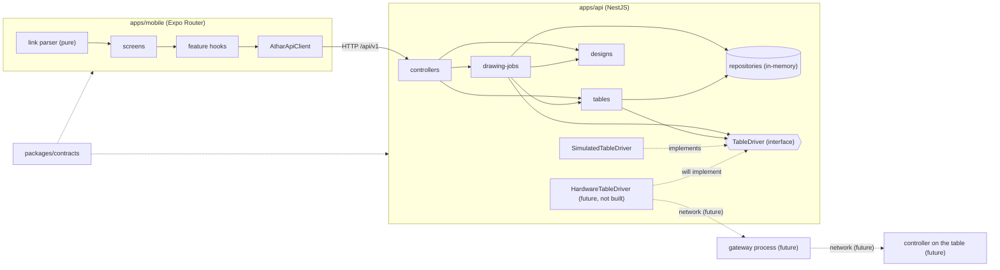
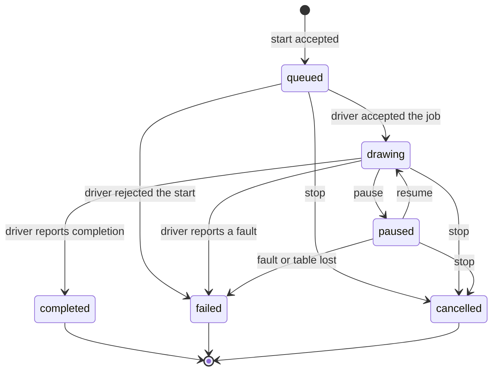
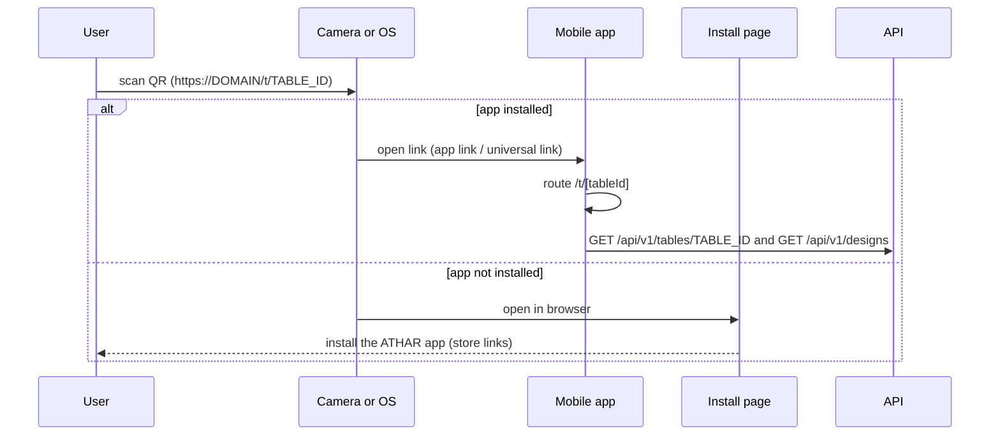
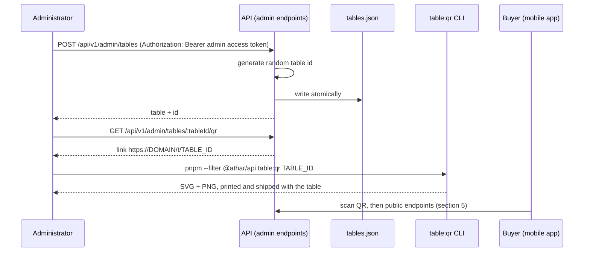

# Architecture

> **Status.** Everything from "Shape" to "Monorepo mechanics" describes what is
> built today (the infrastructure foundation). The section
> [Target architecture: simulated end-to-end journey](#target-architecture-simulated-end-to-end-journey)
> at the end of this file defines what the next milestone builds. Nothing in it
> is implemented yet, and parts of it are proposals; they are collected in
> [Open decisions](#9-open-decisions). The gaps it responds to are in
> [gap-analysis.md](gap-analysis.md).

## Shape

ATHAR is a pnpm workspace with two deployable applications and two internal
packages.

```
apps/mobile  ──┐                    ┌──  apps/api
               ├── @athar/contracts ─┤
apps/api    ───┘                    └──
packages/config  (lint/format only, not shipped)
```

`@athar/contracts` is the only coupling between the two applications. It holds
wire-level schemas only, so neither side depends on the other's internals.

## Boundaries

### `apps/api` (NestJS)

| Directory          | Responsibility                                                     |
| ------------------ | ------------------------------------------------------------------ |
| `src/config`       | Environment schema, validation, typed `AppConfig`, injection token |
| `src/logging`      | `pino`/`nestjs-pino` setup, redaction, transport selection         |
| `src/lifecycle`    | Signal handling and the bounded-grace-period shutdown watchdog     |
| `src/health`       | Liveness and readiness probes                                      |
| `src/common`       | Request validation, exception filter, shared helpers               |
| `src/bootstrap.ts` | Application composition; shared by `main.ts` and the tests         |

Rules that hold across the service:

- Nothing reads `process.env` outside `src/config`. Everything receives
  `AppConfig` through the `APP_CONFIG` token.
- `AppModule.forRoot(config)` takes an already-validated configuration, so the
  module graph is a pure function of its input and tests build the real
  application rather than a stand-in.
- Cross-cutting HTTP concerns (body-parser limit, prefix, versioning, 404
  handling) are applied in one place: `src/bootstrap.ts`.

### `apps/mobile` (Expo)

| Directory      | Responsibility                                                     |
| -------------- | ------------------------------------------------------------------ |
| `src/app`      | Expo Router routes and the root layout that mounts providers       |
| `src/config`   | `EXPO_PUBLIC_*` reading, validation, platform-aware URL resolution |
| `src/api`      | HTTP transport and the typed client bound to API routes            |
| `src/theme.ts` | Design tokens for the current shell                                |

Rules that hold across the app:

- No screen constructs a URL. They consume `AtharApiClient`, which reads
  `environment.apiBaseUrl`.
- `HttpClient` has no React or navigation imports, so transport behaviour is
  testable in a plain Node environment.
- Every response is validated against a `@athar/contracts` schema before it
  reaches a component.

### `packages/contracts`

Zod schemas plus inferred TypeScript types for:

- the health and readiness payloads,
- the error envelope,
- the API version and prefix constants.

The target architecture adds the table, design, job and error-code schemas
(see [section 3](#3-domain-model) and [section 5](#5-rest-api-v1)).

It must never import NestJS, React Native, or anything else framework-specific.
If a type here needs a framework to exist, it does not belong here.

### `packages/config`

ESLint flat configs and the Prettier options. It contains no logic and no
runtime dependency on the applications; the linting toolchain itself is owned by
the workspace root so a single copy is installed.

## Request flow

1. The mobile app resolves `apiBaseUrl` from configuration at startup.
2. `AtharApiClient` issues a request through `HttpClient`, which enforces a
   timeout and parses the body.
3. NestJS applies the JSON body parser, the global prefix and URI versioning.
4. `ZodValidationPipe` validates the payload at the boundary and raises
   `ValidationFailedException` carrying field-level details.
5. `ApiExceptionFilter` renders every failure as the single error envelope,
   including framework-generated ones (unknown route, malformed JSON).

## Cross-cutting concerns

**Routing.** Operational probes are mounted outside the versioned prefix
(`/health`, `/ready`) because orchestrators and uptime monitors address them by
a fixed path. Everything else lives under `/api/v1`.

**Configuration.** The API validates its whole environment once at startup and
fails fast, listing every problem. The mobile app validates at import time and
surfaces a configuration error on the startup screen rather than failing later
with a confusing network error.

**Logging.** The API emits newline-delimited JSON (pretty-printed in
development). `authorization`, `cookie` and the correlation header are redacted
by pino itself. Health probes are excluded from automatic request logging to
keep the signal-to-noise ratio usable. Health and readiness responses carry no
environment values, host names or dependency details.

**Shutdown.** `SIGINT`/`SIGTERM` stop the HTTP server and let in-flight requests
finish. `ShutdownCoordinator` arms a bounded watchdog; if the graceful path
does not complete within `SHUTDOWN_TIMEOUT_MS`, the process exits anyway so a
hung connection cannot keep a container alive forever.

## Deliberate omissions

No database, cache, queue, authentication provider or third-party service is
installed. Adding one is a decision with a cost, and none is justified by
anything that exists yet. Each candidate, and the requirement that would
justify it, is recorded in
[future-infrastructure-decisions.md](future-infrastructure-decisions.md).

## Monorepo mechanics

pnpm does not hoist dependencies into a single `node_modules`, which Metro does
not assume. `apps/mobile/metro.config.js` therefore points Metro at the
workspace root and keeps the default hierarchical lookup **enabled** — pnpm
stores each package's dependencies under `node_modules/.pnpm/<pkg>/node_modules`,
so a package can only find its own dependencies by walking up from its real
location in the store. Disabling that lookup breaks transitive imports such as
`@expo/metro-runtime`.

**Contracts are consumed from source, except in production.**
`@athar/contracts` declares a custom export condition, `athar-source`, that
points at `src/index.ts` ahead of the compiled `dist/`:

| Consumer                            | Mechanism                                                                                       | Needs `dist/`? |
| ----------------------------------- | ----------------------------------------------------------------------------------------------- | -------------- |
| `tsc` typecheck, IDE (API, mobile)  | `customConditions: ["athar-source"]` in the app's `tsconfig.json`                               | No             |
| Vitest (API, mobile)                | `resolve.alias` to `packages/contracts/src/index.ts`                                            | No             |
| Metro                               | `resolveRequest` in `metro.config.js` maps the package to its source (and `./x.js` to `./x.ts`) | No             |
| API build (`tsconfig.build.json`)   | `customConditions: []`: resolves to the compiled declarations, so `rootDir` stays `src`         | Yes            |
| API at runtime (dev and production) | Node loads the compiled `dist/index.js`                                                         | Yes            |

Production is therefore unchanged: `pnpm build` builds contracts first
(`pnpm -r` follows the dependency order), then the API against its declarations.
The dev server needs `dist/` only because Node 20 cannot run TypeScript; the
contracts watcher in `pnpm dev` keeps it fresh. The condition name is
deliberately specific: a generic `source` condition would also switch any
third-party package that defines one.

The root `eslint.config.js` is the single lint entry point. Rules are scoped by
file type rather than duplicated per package, which keeps the mobile app, the
API and the shared packages from drifting apart.

# Target architecture: simulated end-to-end journey

Scope of this milestone: a user scans a table's QR code, lands on that table's
screen, browses four designs, picks one, starts a drawing, watches its progress
on a **simulated** table, sees completion or an error, and can start again.

Nothing here is built yet. Statements are requirements unless they are marked
**Proposal**; every proposal is listed in [Open decisions](#9-open-decisions).

Path note: because of the global prefix and URI versioning already in place
([api-conventions.md](api-conventions.md)), `/api/v1/tables/:tableId` is the
full path of what the requirement list calls `/v1/tables/:tableId`. The full
form is used below.

## Blocking pre-work

These defects from [gap-analysis.md](gap-analysis.md) sit directly under the
target design and must be fixed first, or the design cannot be verified.
**Status: fixed** (gaps 3.1, 3.2, 3.3, 3.5 and 3.6, and the filter part of the
error-code work); how is described under
[Monorepo mechanics](#monorepo-mechanics) and in
[development-setup.md](development-setup.md).

| Gap                                             | Why it blocks this design                                                     |
| ----------------------------------------------- | ----------------------------------------------------------------------------- |
| 3.1 `pnpm dev:api` / `pnpm dev` broken          | Nobody can run the API and the app together to try the journey                |
| 3.2 `EXPO_PUBLIC_*` not inlined in the bundle   | The app cannot be pointed at a LAN API, and the link-host setting (6) is lost |
| 3.3 application logs bypass pino                | Job lifecycle logging would ignore `LOG_LEVEL`, redaction and JSON output     |
| 3.5 contracts consumed from `dist/`             | Contracts will change constantly; a stale `dist` produces misleading failures |
| 3.6 error filter maps only 400/404/503 to codes | Domain conflicts (409) would be reported as `BAD_REQUEST`                     |

## 1. Components and boundaries



Solid arrows are the direction of calls. Dotted arrows are compile-time
dependencies, "implements" relations, or links that do not exist yet. The API
never calls the mobile app, and `tables`, `designs` and `drawing-jobs` never
reference a concrete driver. The phone has no path to the table: the only route
from the app to a table is app → API → driver.

### Responsibilities

| Component            | Owns                                                                                                                            | Must not                                                         |
| -------------------- | ------------------------------------------------------------------------------------------------------------------------------- | ---------------------------------------------------------------- |
| `apps/mobile`        | Screens, link/QR handling, polling, presentation of mode and state                                                              | Contain simulator logic, know trajectories, or build URLs        |
| `apps/api`           | Domain rules, the job state machine, validation, the driver boundary                                                            | Import mobile code; let a controller call a concrete driver      |
| `packages/contracts` | Wire schemas: table, design, job, error codes, table id                                                                         | Import NestJS/React Native; carry trajectories or driver details |
| `tables` (API)       | Table registry (persisted), `enabled` flag, derived connection status, the admin provisioning endpoints behind an admin session | Own job state                                                    |
| `designs` (API)      | The four static designs and their trajectories (versioned data in the repo)                                                     | Be writable at runtime                                           |
| `drawing-jobs` (API) | `DrawingJob` records, the state machine, one-active-job rule, idempotency                                                       | Know how a table moves sand                                      |
| `device` (API)       | `TableDriver`, `SimulatedTableDriver`, driver selection from `TABLE_MODE`                                                       | Be bypassed: everything else uses the `TableDriver` token        |

Dependency rules (code review, and lint `no-restricted-imports` where
practical):

- `tables`, `designs` and `drawing-jobs` depend on the **`TableDriver` token
  only**. Only the device module imports a concrete driver.
- `drawing-jobs` is the single writer of job state. A driver reports what the
  table is doing; `drawing-jobs` decides what that means for the job
  ([section 4](#4-drawing-job-state-machine)).
- Mobile and API share only `@athar/contracts`.

### Operating mode

`TABLE_MODE` is validated in `environment.schema.ts` like every other variable:

```ts
TABLE_MODE: z.enum(['simulation', 'hardware']).default('simulation'),
```

- `simulation` (default): `SimulatedTableDriver` is bound to the `TableDriver`
  token.
- `hardware`: **the process refuses to start** with a dedicated, readable error
  until a hardware driver exists:

  ```
  TABLE_MODE=hardware is not available: no hardware table driver is installed in this build.
  Set TABLE_MODE=simulation.
  ```

  The check lives in the driver factory (`createTableDriver(config)`), which runs
  while the module graph is created, before the server binds a port. It throws a
  `StartupConfigurationError`; `main.ts` prints its message verbatim, the way it
  already prints `EnvironmentValidationError`, instead of the generic "Failed to
  start the API." with a stack trace.

- The resolved mode is part of `AppConfig`; nothing else decides the mode, and
  no client can influence it.

`HardwareTableDriver` is **described, not created**, in this milestone. It will
implement the same `TableDriver` interface, own the transport to the real
controller, and be selected by the same factory. Its arrival must require no
change to `tables`, `designs`, `drawing-jobs`, the controllers, the contracts or
the mobile app. If it does, the interface was wrong: fix the interface first.

## 2. `TableDriver` interface

The interface is the only way the rest of the API reaches a table. It is
expressed in domain terms and names no serial port, broker, controller
firmware, G-code dialect or transport, so it cannot only be implemented for one
of them.

### Command path

Every command takes one route, and no step can be skipped:

```
phone  ──HTTPS over the internet──▶  backend  ──▶  table controller
                                    (API: rules,        (the simulator replaces
                                     state machine,      the controller for now)
                                     TableDriver)
```

- The **phone sends commands to the backend over the internet** (`POST
.../jobs`, `pause`, `resume`, `stop`). The phone never talks to the table, so
  it needs no proximity, no radio and no knowledge of how the table works.
- The **backend validates and applies the rules** (one active job per table,
  the state machine, idempotency) and only then calls the `TableDriver`.
- The **driver forwards the command to the table's controller**. In this
  milestone there is no controller: `SimulatedTableDriver` sits in its place and
  answers exactly as a controller would through the interface, so everything
  above the driver is the production code path. A future `HardwareTableDriver`
  replaces the simulator and forwards to the real controller over the network
  (below); nothing above the driver changes.
- Status flows back the same way: controller (or simulator) → driver →
  `drawing-jobs` → the job the phone polls.

```ts
// apps/api/src/device/table-driver.ts

/** Whether a status describes a simulated or a physical table. */
export type TableMode = 'simulation' | 'hardware';

export type DriverConnection = 'online' | 'offline' | 'busy' | 'error';

/** What the table is doing right now, from the driver's point of view. */
export type DriverPhase = 'idle' | 'drawing' | 'paused' | 'completed' | 'failed' | 'cancelled';

/** Failure reasons a driver can report. Transport-neutral. */
export type DriverErrorCode =
  | 'OFFLINE' //             the table cannot be reached
  | 'BUSY' //                the table is already executing something
  | 'TRAJECTORY_REJECTED' // the table cannot draw this trajectory
  | 'FAULT' //               the table reported a fault while drawing
  | 'SIMULATED_FAULT'; //    only ever produced by SimulatedTableDriver

export class DriverError extends Error {
  constructor(
    readonly code: DriverErrorCode,
    message: string,
  ) {
    super(message);
    this.name = 'DriverError';
  }
}

/** Snapshot of a table. Every status carries `mode`; there is no mode-less form. */
export interface DriverStatus {
  readonly tableId: string;
  readonly mode: TableMode;
  readonly connection: DriverConnection;
  readonly phase: DriverPhase;
  /** Job the table is executing or has just finished, if any. */
  readonly jobId: string | null;
  /** Fraction of the trajectory completed, 0..1. 0 when there is no job. */
  readonly progress: number;
  readonly errorCode: DriverErrorCode | null;
  /** ISO-8601 UTC time at which the driver observed this state. */
  readonly observedAt: string;
}

/** Progress and status changes are the same shape: a new snapshot. */
export type DriverEvent = DriverStatus;

export type Unsubscribe = () => void;

/**
 * Named for the driver side, to keep it apart from `StartJobRequest` in
 * `@athar/contracts`, which is the HTTP request body.
 */
export interface DriverStartRequest {
  /** Chosen by the API; the driver echoes it in every status it emits. */
  readonly jobId: string;
  readonly trajectory: Trajectory; // see section 3
  /**
   * How long the drawing is expected to take. The simulator paces itself with
   * it; a hardware driver ignores it. Optional: the simulator falls back to 60 s.
   */
  readonly estimatedDurationSeconds?: number;
}

export interface TableDriver {
  /** Fixed for the lifetime of the driver; equals `mode` in every status it emits. */
  readonly mode: TableMode;

  getStatus(tableId: string): Promise<DriverStatus>;

  /** Resolves once the table has accepted the job. Rejects with `DriverError`. */
  startJob(tableId: string, request: DriverStartRequest): Promise<void>;

  pause(tableId: string, jobId: string): Promise<void>;
  resume(tableId: string, jobId: string): Promise<void>;
  /** Aborts the job. Whatever has been drawn stays drawn; it is not undone. */
  stop(tableId: string, jobId: string): Promise<void>;

  /**
   * Receive every status change and progress update for one table, in order.
   * Returns a function that ends the subscription.
   */
  subscribe(tableId: string, listener: (event: DriverEvent) => void): Unsubscribe;
}

export const TABLE_DRIVER = Symbol('TABLE_DRIVER');
```

Rules for every implementation:

1. **`mode` is mandatory and truthful.** The API copies it into the `Table` and
   into each `DrawingJob` at creation ([section 3](#3-domain-model)), so history
   is never relabelled and the app can never present a simulated drawing as a
   real one.
2. **Commands resolve when the table has accepted them**, not when it has
   finished. Progress and completion arrive through `subscribe`.
3. **Failures are `DriverError`s with a transport-neutral code.** Transport
   specifics (a serial timeout, a lost broker connection) are mapped inside the
   implementation and logged there; they never cross the interface.
4. **Events are ordered per table and delivered at least once.** Listeners must
   tolerate a repeated status. A throwing listener must not break the driver.
5. **The driver stores no domain state.** It knows nothing about designs, users,
   history or idempotency.
6. **Progress is path-length based** (fraction of total trajectory length), not
   point-index based, so it is smooth and independent of point density.

### `SimulatedTableDriver`

- A pure state machine per table driven by an **injectable `Clock`**. Progress
  is a function of `elapsed = now - startedAt - pausedTotal` divided by
  `estimatedDurationSeconds / SIMULATION_SPEED_FACTOR` (the duration comes from
  `DriverStartRequest`; 60 s if it is absent). The simulated table moves at a
  constant speed along the path, so elapsed fraction is path-length fraction.
  There are no per-job timers to leak across tests; one injectable scheduler
  tick (every 250 ms) re-evaluates active tables and notifies subscribers.
  Completion and injected faults are noticed lazily, on the next command,
  `getStatus` or tick after the clock reaches them.
- Events are delivered in the order the changes happened, even if a listener
  calls back into the driver, and a throwing listener is logged and ignored.
- Fault injection for the error path is configuration, not a request parameter:
  `SIMULATION_FAULT_EVERY_NTH_JOB` and `SIMULATION_FAULT_AT_PROGRESS`. A faulted
  job ends with `SIMULATED_FAULT`. The same inputs always give the same outcome.
  "Every Nth job" counts accepted jobs across all tables, and a faulted job never
  reaches progress 1 (a fault asked for at 1 happens at 0.999), because a job's
  progress is 1 if and only if it completed.
- The simulator keeps state for any table id it is asked about (there is no
  table registry yet; the `tables` module will decide which ids exist) and
  reports it `online`. The `offline` and `error` paths are exercised in tests
  through `simulateConnection`, a test-only control that is not part of
  `TableDriver`. Taking a table offline or into error fails a job in progress
  with `OFFLINE` or `FAULT`.
- A command that names a job the table is not running, or that its phase does
  not allow (pausing a finished job), throws `InvalidDriverCommandError`, not
  `DriverError`: the job state machine should have prevented it, so it is a
  programming error, not an outcome a job can end with.
- State is in memory. An API restart forgets a running simulated drawing; the
  app treats `404` for a known job id as a normal state
  ([section 7](#7-mobile-app-structure)).

### `HardwareTableDriver` (future; description only)

Decided: **the table connects to the backend over the network, and the phone
never talks to the table directly.** The reasons are that tables sit in public
venues and play unattended, and that routing everything through the backend
keeps access control and job rules in one place
([future-infrastructure-decisions.md](future-infrastructure-decisions.md)).

`HardwareTableDriver` therefore lives on the **backend side**, behind this
interface. It will talk to a controller on the table over the network, most
likely through a separate gateway process that holds the long-lived
connections, so they stay away from request handling. In terms of the diagram in
[section 1](#1-components-and-boundaries): the driver is a client of the
gateway, and the gateway is the peer of the table's controller.

What is still open ([Open decisions](#9-open-decisions)): the controller
hardware and the transport between gateway and controller; the interface above
deliberately names neither. Device framing remains a separate contract from the
HTTP API. Until the driver exists, `TABLE_MODE=hardware` cannot start.

## 3. Domain model

Wire schemas live in `@athar/contracts` (Zod, inferred types). The trajectory
and the raw design data are API-internal.

### Table

| Field         | Type                                         | Notes                                                            |
| ------------- | -------------------------------------------- | ---------------------------------------------------------------- |
| `id`          | string                                       | **Public, non-secret.** Appears in QR codes. Format below        |
| `displayName` | string                                       | Shown to the user                                                |
| `location`    | string                                       | Human label, e.g. a room or venue name                           |
| `enabled`     | boolean                                      | Operator switch. A disabled table accepts no new jobs            |
| `mode`        | `'simulation' \| 'hardware'`                 | Taken from the driver, never from the client                     |
| `connection`  | `'online' \| 'offline' \| 'busy' \| 'error'` | Derived: driver connection, and `busy` while a job is active     |
| `activeJobId` | string \| null                               | Lets a second visitor open the running job instead of a dead end |

`id` format: lowercase `[a-z0-9-]`, 3 to 40 characters, one shared Zod schema
(`tableIdSchema`) used by the API pipe and the mobile link parser. Ids are
**generated by the server** when an administrator registers a table
([Table provisioning](#table-provisioning-admin)): random, non-guessable
(80 bits), immutable. Ids are public, so they are not a credential; being
random makes enumeration infeasible, but does not stop someone who photographs
the printed QR code ([section 6](#6-qr-code-and-deep-link-flow)).

The table's stored record (`id`, `displayName`, `location`, `enabled`,
`createdAt`, `updatedAt`) is owned by the `tables` module and persisted
(section 8). `mode`, `connection` and `activeJobId` are not stored: they are
composed from the driver and `drawing-jobs` on each read.

### Design

| Field               | Type                     | Notes                                                                 |
| ------------------- | ------------------------ | --------------------------------------------------------------------- |
| `id`                | string                   | Stable identifier                                                     |
| `slug`              | string                   | URL-safe, unique                                                      |
| `title`             | `{ en, ar }`             | Localised text (see below)                                            |
| `description`       | `{ en, ar }`             | Short; localised                                                      |
| `inspiration`       | object                   | See below; its `note` is localised                                    |
| `estimatedDuration` | seconds                  | Used by the simulator; shown to users as an estimate                  |
| `previewPath`       | `[theta, rho][]`, <= 500 | **Detail response only.** Downsampled from the trajectory (see below) |
| `trajectory`        | `Trajectory`             | **API-internal.** Never returned by the HTTP API                      |

**Localised text.** `title`, `description` and `inspiration.note` are
`{ en: string, ar: string }`, both languages required. The API returns both and
the app picks one by the user's language, so switching language needs no extra
request. Other text on the design (source labels) is not localised yet; see
open decision 17.

```ts
type LocalizedText = { readonly en: string; readonly ar: string };

interface DesignInspiration {
  readonly kind: 'documented-traditional' | 'original-modern';
  /** Note shown on the design details screen. */
  readonly note: LocalizedText;
  /** References backing the note. */
  readonly sources: readonly { readonly label: string; readonly url?: string }[];
}
```

Rules, enforced by the Zod schema that validates the static data at startup:

- `documented-traditional` requires **at least one source**. The label means
  "we can point to documentation", so it cannot be set without one.
- `original-modern` may have no sources, but its `note` must say it is an
  original interpretation. It must not borrow the vocabulary of a tradition it
  does not document.
- Content (titles, notes, sources, which label applies) is authored and
  reviewed by the product owner. This document defines the shape, not the
  content, and asserts no provenance.

**Exactly four designs** ship in the initial collection, as versioned static
data in the repository (`apps/api/src/designs/data/designs.v1.ts`, exporting
`{ collectionVersion: 1, designs: [...] }`). Startup validation fails if the
count is not four, an id or slug repeats, or any design violates the schema.
No database is involved. Changing the collection is a reviewed code change with
a `collectionVersion` bump.

The designs endpoints never return `trajectory`: shipping it would couple the
app to the drawing engine. The list endpoint omits `previewPath` as well to stay
small; the detail endpoint returns it.

### Trajectory (proposal; validate once the mechanics are chosen)

```ts
interface Trajectory {
  readonly format: 'polar-theta-rho/v1';
  /** Ordered points. theta in radians, unwrapped; rho normalised to 0..1. */
  readonly points: readonly (readonly [theta: number, rho: number])[];
}
```

- `rho` is the distance from the table centre as a fraction of the table radius
  (`0` centre, `1` edge). Designs do not depend on a physical table size; a
  driver scales to its own radius.
- `theta` is **unwrapped** (it can exceed `2π` and keep increasing), so a spiral
  is a monotonic sequence rather than a series of discontinuities at the wrap
  point, and a driver never has to guess the direction of a move.
- Points are joined by linear interpolation **in polar space**, the natural
  motion for polar kinematics, which keeps radial and circular moves exact.
- Progress is cumulative polar path length up to the current position divided by
  total path length.
- Designs must start and end at the **same** rho, so that any design can follow
  any other, and the same one can repeat, without a jump. The value depends on
  the mechanics (where the ball can rest) and is **not decided**. It is a single
  named constant, `HOME_RHO` in `apps/api/src/designs/home.ts`, set to the
  centre (0) for now: at the centre the angle is meaningless, so chaining is
  continuous whatever angle the last drawing stopped at, whereas at the rim the
  end angle of one design would have to equal the start angle of the next. Every
  design is validated against it at startup. Because the shipped designs are
  drawn as out-and-back paths that return to the centre, choosing the rim means
  redrawing them, not only changing the constant.

Why this and not the alternatives: G-code is controller-specific, so it would
put one protocol into the data and into the interface. Cartesian XY suits a
gantry table but needs resampling for a polar one. Normalised polar points
convert to either with a small, testable function and are compact enough to keep
four designs as static source. **This is a proposal.** If the mechanics turn out
to be Cartesian, only this type, the simulator's path-length function and the
preview convention below change; the interface, the job model and the endpoint
set are unaffected. The format is versioned (`/v1`) so a revision never silently
reinterprets stored designs.

### Preview path

The app needs a picture of a design and, on the progress screen, the part drawn
so far. It gets this from `previewPath`, not from the trajectory:

- `previewPath` is a list of `[theta, rho]` points, **at most 500**, in the same
  `polar-theta-rho/v1` convention as the trajectory (unwrapped theta in radians,
  rho normalised to the table radius).
- It is **derived from the trajectory once, at startup**, when the static
  designs are validated, and kept in memory. It is never authored by hand, so it
  cannot drift from the design it previews. Startup fails if a design yields
  fewer than 2 points.
- The reduction is **tolerance-based simplification** (Douglas-Peucker), not
  even spacing. Every preview point is a point of the trajectory itself, in its
  own unwrapped convention; the first and last are always kept; the tolerance is
  the smallest that fits the 500-point budget, so the preview is as faithful as
  the budget allows, and a trajectory already short enough is returned whole.
  _Even path-length spacing was tried first, as this section originally
  specified, and measured worse:_ on a design built of straight strokes and sharp
  turns the corners fall between samples and are cut off (the palm-fronds
  preview came out 21% shorter than the design), and the tight turns near the
  centre of a spiral are under-sampled. Simplification keeps exactly the points
  that matter. For the shipped designs the worst a dropped point strays from the
  preview is 0.7% of the table radius (the dunes, which use the whole budget) or
  less (the star and the fronds are exact), and the preview's length is within
  2% of the design's.
- The preview is still an approximation, and its path length is only
  approximately the real one, so the drawn-so-far overlay can differ from the
  true position by a small amount. It is a display aid, not a measurement.
- The full trajectory stays API-internal. `previewPath` must never be sent to a
  driver.
- **Drawn part.** The app shows the part of the path drawn so far by taking the
  prefix of `previewPath` whose cumulative path length is `job.progress` times
  its total length, interpolating inside the last segment. This is **the same
  rule the driver uses** for progress (cumulative path length over total path
  length, section 2), applied to a coarser path. Both sides must use one shared
  definition of "path length" (including how a polar-linear segment is
  measured). **As built:** it lives in `packages/contracts/src/polar-path.ts`
  (`polarSegmentLength`, `cumulativePathLengths`, `polarPathLength`,
  `locateAlongPath`), pure data-in/data-out; the API's `trajectory.ts` re-exports it
  and the app's preview geometry uses it, so there is one definition.

### DrawingJob

| Field        | Type                                                              | Notes                                         |
| ------------ | ----------------------------------------------------------------- | --------------------------------------------- |
| `id`         | string (UUID)                                                     | Server-generated                              |
| `tableId`    | string                                                            |                                               |
| `designId`   | string                                                            |                                               |
| `mode`       | `'simulation' \| 'hardware'`                                      | Copied from the driver at creation; immutable |
| `state`      | `queued \| drawing \| paused \| completed \| failed \| cancelled` | See section 4                                 |
| `progress`   | number, 0..1                                                      | Never decreases; `1` if and only if completed |
| `createdAt`  | ISO-8601 UTC                                                      |                                               |
| `startedAt`  | ISO-8601 UTC \| null                                              | First entry into `drawing`                    |
| `updatedAt`  | ISO-8601 UTC                                                      |                                               |
| `finishedAt` | ISO-8601 UTC \| null                                              | Entry into a terminal state                   |
| `errorCode`  | `JobErrorCode \| null`                                            | Set if and only if `failed`                   |

`JobErrorCode` is `DriverErrorCode` (section 2). It is a field **inside a job**
and is separate from the HTTP error codes in [section 5](#5-rest-api-v1).

**No personal data.** A job has no user id, device id, name, IP address or
free-text field. The client request id used for idempotency is kept server-side
for deduplication and is not returned.

## 4. Drawing job state machine



Active states: `queued`, `drawing`, `paused`. Terminal states: `completed`,
`failed`, `cancelled`.

### Allowed transitions

| From      | To          | Trigger                                                     | Effects                                      |
| --------- | ----------- | ----------------------------------------------------------- | -------------------------------------------- |
| (none)    | `queued`    | `POST /tables/:tableId/jobs` passes every check             | Job created; the table now has an active job |
| `queued`  | `drawing`   | `driver.startJob` resolves and the driver reports `drawing` | `startedAt` set                              |
| `queued`  | `failed`    | `driver.startJob` rejects with a `DriverError`              | `errorCode`, `finishedAt` set                |
| `queued`  | `cancelled` | `POST /jobs/:jobId/stop`                                    | `finishedAt` set                             |
| `drawing` | `paused`    | `POST /jobs/:jobId/pause`, once `driver.pause` resolves     | Progress frozen                              |
| `paused`  | `drawing`   | `POST /jobs/:jobId/resume`, once `driver.resume` resolves   | Progress continues                           |
| `drawing` | `completed` | Driver event: phase `completed`                             | `progress = 1`, `finishedAt` set             |
| `drawing` | `failed`    | Driver event: phase `failed`                                | `errorCode`, `finishedAt` set                |
| `paused`  | `failed`    | Driver event: phase `failed`, or the table goes offline     | `errorCode`, `finishedAt` set                |
| `drawing` | `cancelled` | `POST /jobs/:jobId/stop`, once `driver.stop` resolves       | `finishedAt` set                             |
| `paused`  | `cancelled` | `POST /jobs/:jobId/stop`, once `driver.stop` resolves       | `finishedAt` set                             |

**Every other transition is rejected** with `INVALID_TRANSITION` (HTTP 409).
This includes any command on a terminal job, `pause` on `queued` or `paused`,
`resume` on anything but `paused`, and completion of a `paused` job (a paused
table is not drawing). The error message names the job's current state so the
client can refresh instead of guessing. A rejection changes nothing.

The machine is a pure function `(state, event) -> state | rejection` inside
`drawing-jobs`, with a test that walks the full state x event matrix.

### One active job per table

At most one job per table is in `queued`, `drawing` or `paused`. A start request
for a table that already has one returns `TABLE_BUSY` (409), whatever the
design. The check and the insert are one synchronous step in the in-memory
repository (no `await` between them), so two requests cannot both pass. The
database equivalent is a partial unique index on `table_id` for active states;
record that when a database is introduced.

A job leaves the active set only by a terminal transition, including `failed`
when the table is lost, so a job cannot hold a table forever.

### Idempotency

`POST /tables/:tableId/jobs` carries a client-generated `clientRequestId`
(UUID v4, created when the user opens the design screen and reused on retry).
The API keeps `(tableId, clientRequestId) -> jobId` for the retained history.

- Same pair and same `designId`: **no new job.** The original job is returned
  with `200` instead of `201`. This is checked **before** the busy check, so a
  double tap that arrives after the first job started returns that job, not
  `TABLE_BUSY`.
- Same `clientRequestId` with a different `designId`: `IDEMPOTENCY_CONFLICT`
  (409).
- A new `clientRequestId` while the table is busy: `TABLE_BUSY`.

The app generates a fresh id for each deliberate "draw again".

### As built: the drawing-jobs module

`apps/api/src/jobs/`. `JobsModule.forRoot` is global and provides
`ACTIVE_JOB_LOOKUP`, the seam `tables` was built with, so `tables` still imports
nothing from `jobs`.

| Piece                   | Role                                                                                                                                 |
| ----------------------- | ------------------------------------------------------------------------------------------------------------------------------------ |
| `job-state-machine.ts`  | The pure state machine, over the transition **data** in `@athar/contracts`. No I/O, no clock, changes nothing it is given            |
| `JobRepository`         | The storage interface; `insertIfNoActive` decides repeat and busy atomically                                                         |
| `InMemoryJobRepository` | Jobs in memory, bounded per table. Lost on restart                                                                                   |
| `JobsService`           | **The only writer of job state.** Starts jobs, runs commands, listens to the driver and applies each event through the state machine |
| `TableJobsController`   | `POST` and `GET /api/v1/tables/:tableId/jobs`                                                                                        |
| `JobsController`        | `GET /api/v1/jobs/:jobId`, and `POST .../pause`, `.../resume`, `.../stop`                                                            |

How it behaves, including the choices the sections above leave open:

- **Driver events are turned back into transitions.** A driver reports what the
  table is doing ("paused"); the service maps that to a job state and finds the one
  trigger that joins the job's state to it (`pause`, `driver-completed`, ...).
  Every pair of states has at most one trigger, so there is never a choice. A report
  the machine has no transition for (a queued job "paused", a paused job
  "completed") is logged at warn level and ignored. A finished job never changes.
- **Commands are judged against fresh state.** Before a command, the driver is asked
  what the table is actually doing and the job is brought up to date, so a stop that
  arrives after the drawing has in fact ended is `INVALID_TRANSITION` ("Cannot stop
  a job that is completed."), not a stop of a finished drawing. After the driver has
  accepted the command, its state is read back; if the driver's status has not caught
  up, the command's own trigger is applied.
- **One order for everything that changes a job.** Commands, starts and driver events
  all run one at a time, in order. A driver event that arrives while a command is
  running waits behind it and then finds the work done. The repository is _also_
  atomic where it decides busy and repeat requests, so correctness does not rest on
  this alone (a test proves a hundred simultaneous starts yield exactly one job).
- **A start the driver refuses.** The job exists and is `failed` with the driver's
  code (`BUSY`, `OFFLINE`, `TRAJECTORY_REJECTED`, ...), and **`POST` returns it with
  `201`**, so the app shows it like any other failure. An _unexpected_ driver error
  also fails the job (`FAULT`), so that it can never hold the table, and is then
  rethrown as a server error.
- **Reads do not touch the driver.** `GET /jobs/:jobId` reports what the service
  last learnt. The simulator announces progress every 250 ms, so a poll is at most
  that stale. Only commands ask the driver directly.
- **`activeJobId` and busy** now come from this module. A table with an active job
  is `busy` even if the driver, not yet caught up, still says `online`; an
  `offline` or `error` table is never reported as busy.
- **Pause, resume and stop on a disabled table are allowed.** Disabling a table
  refuses _new_ jobs only; an operator who switches a table off must not strand a
  visitor's running drawing.
- **`limit` on the history is not rejected for being above `JOB_HISTORY_LIMIT`.**
  The contract allows 1 to 100 and the response holds what is retained, so a client
  can always ask for 100.
- **Jobs do not survive a restart, and the dev server restarts on every save.** In
  `pnpm dev:api` a saved file restarts the API, which forgets every job; the app must
  treat `JOB_NOT_FOUND` for a job it knows as a normal state (section 7), and a
  developer should expect it. (An earlier version of the dev loop also restarted the
  API a few seconds _after_ it first answered, because the watcher's first emit
  rewrote `dist`. Found by running the journey by hand, fixed with incremental builds;
  see development-setup.md.)
- **Logging.** Each job is logged by id, table, design and mode when it is queued,
  and once for each change of state (`Job <id> on table <tableId>: drawing ->
paused`). Progress-only updates are not logged. A job carries no personal data and
  neither does its log: the client's request id is not logged, and neither is
  anything about the caller.

## 5. REST API v1

Routes are versioned `v1` automatically under the `api` prefix. Request parts
are validated with `ZodValidationPipe` (`body`, `query`, `params`); a bad id or
body yields `VALIDATION_FAILED`. Success responses are plain objects with no
envelope. Every failure uses the existing error envelope.

### Error codes

`apiErrorCodeSchema` is extended **additively**, which the versioning policy
allows within `v1`. The filter must change to honour a `code` carried by domain
exceptions rather than deriving it from the status alone (gap 3.6).

| Code                   | HTTP | Meaning                                          |
| ---------------------- | ---- | ------------------------------------------------ |
| `VALIDATION_FAILED`    | 400  | Existing. Bad body, query or path parameter      |
| `TABLE_NOT_FOUND`      | 404  | Unknown table id                                 |
| `DESIGN_NOT_FOUND`     | 404  | Unknown design id                                |
| `JOB_NOT_FOUND`        | 404  | Unknown job id, including after an API restart   |
| `TABLE_DISABLED`       | 409  | The table exists but `enabled` is false          |
| `TABLE_OFFLINE`        | 409  | The driver reports the table offline or in error |
| `TABLE_BUSY`           | 409  | The table already has an active job              |
| `INVALID_TRANSITION`   | 409  | Command not allowed in the job's current state   |
| `IDEMPOTENCY_CONFLICT` | 409  | `clientRequestId` reused with a different design |
| `UNAUTHORIZED`         | 401  | No session, or an unknown access token           |

Since Phase 3 every endpoint in this section needs a session, so each can also
answer `UNAUTHORIZED` or `SESSION_EXPIRED`; see
[Orders, entitlements and ownership](#orders-entitlements-and-ownership). The
session codes are listed in [api-conventions.md](api-conventions.md#sessions).
The existing codes keep their meaning. Check order for
`POST /tables/:tableId/jobs`: session, validation, table exists **and is the
caller's**, design exists,
idempotency replay, table enabled, table online, table not busy.

### Resource shapes

```ts
type Table = {
  id: string;
  displayName: string;
  location: string;
  enabled: boolean;
  mode: 'simulation' | 'hardware';
  connection: 'online' | 'offline' | 'busy' | 'error';
  activeJobId: string | null;
};

type LocalizedText = { en: string; ar: string };

type DesignSummary = {
  id: string;
  slug: string;
  title: LocalizedText;
  description: LocalizedText;
  inspiration: DesignInspiration; // its `note` is a LocalizedText
  estimatedDurationSeconds: number;
};

/** Detail adds the preview; the trajectory is never exposed. */
type DesignDetail = DesignSummary & {
  previewPath: [theta: number, rho: number][]; // 2..500 points, polar-theta-rho/v1
};

type DrawingJob = {
  id: string;
  tableId: string;
  designId: string;
  mode: 'simulation' | 'hardware';
  state: 'queued' | 'drawing' | 'paused' | 'completed' | 'failed' | 'cancelled';
  progress: number;
  createdAt: string;
  startedAt: string | null;
  updatedAt: string;
  finishedAt: string | null;
  errorCode: DriverErrorCode | null;
};
```

### Endpoints

All paths below are relative to the service root. All need a session except
`/health` and `/ready`; a table (and its jobs) that is not the caller's answers
as if it did not exist
([Orders, entitlements and ownership](#orders-entitlements-and-ownership)).

**`GET /api/v1/tables/:tableId`**

- Request: path `tableId`.
- Response: `200` `Table`.
- Errors: `VALIDATION_FAILED`, `TABLE_NOT_FOUND`.
- A disabled table returns `200` with `enabled: false`, so the app can explain
  it; only commands are refused.

**`GET /api/v1/designs`**

- Request: none.
- Response: `200` `{ collectionVersion: number, designs: DesignSummary[] }`, always four items.
  No `previewPath`, to keep the list small.
- Errors: none specific.

**`GET /api/v1/designs/:designId`**

- Request: path `designId`.
- Response: `200` `DesignDetail`, which includes `previewPath`.
- Errors: `VALIDATION_FAILED`, `DESIGN_NOT_FOUND`.

**`POST /api/v1/tables/:tableId/jobs`**

- Request: body `{ designId: string, clientRequestId: string (UUID) }`.
- Response: `201` `DrawingJob` for a new job; `200` `DrawingJob` for an
  idempotent replay.
- Errors: `VALIDATION_FAILED`, `TABLE_NOT_FOUND`, `DESIGN_NOT_FOUND`,
  `TABLE_DISABLED`, `TABLE_OFFLINE`, `TABLE_BUSY`, `IDEMPOTENCY_CONFLICT`.

**`GET /api/v1/jobs/:jobId`**

- Request: path `jobId`.
- Response: `200` `DrawingJob`. Reads have no side effects.
- Errors: `VALIDATION_FAILED`, `JOB_NOT_FOUND`.

**`POST /api/v1/jobs/:jobId/pause`, `/resume`, `/stop`**

- Request: path `jobId`; empty body.
- Response: `200` the updated `DrawingJob`, so the app needs no second round trip.
- Errors: `VALIDATION_FAILED`, `JOB_NOT_FOUND`, `INVALID_TRANSITION`.

**`GET /api/v1/tables/:tableId/jobs`**

- Request: path `tableId`; query `limit` (integer, 1 to `JOB_HISTORY_LIMIT`, default 10).
- Response: `200` `{ jobs: DrawingJob[] }`, newest first.
- Errors: `VALIDATION_FAILED`, `TABLE_NOT_FOUND`.

**`GET /health`** (existing, unchanged) and **`GET /ready`** (extended; below).

Job ids are random UUIDs. Knowing one is not authorisation
([section 6](#6-qr-code-and-deep-link-flow)).

### Health and readiness extension

`/health` stays exactly as it is, including the e2e assertion that it exposes
five fields and nothing else. The simulator status is added to **`/ready`**:

- a new probe `{ name: 'table-driver', status }`, `ok` when the driver is
  constructed and answers `getStatus` for every seeded table, added in
  `HealthService.getReadiness()`, the single place a dependency becomes
  readiness-relevant;
- a new top-level field `tableMode: 'simulation' | 'hardware'`. It names the mode
  only. No seed data, durations or fault settings are exposed.

This is a deliberate, small widening of the "health exposes nothing" rule, made
because the requirement is to see simulator status. It is listed in
[Open decisions](#9-open-decisions). The mobile diagnostics screen displays it.

**As built:** `HealthService` injects the driver and the table registry, and the
probe is `ok` when the driver answers `getStatus` for every registered table. A
failing probe returns only its name and status; which table failed, and why, is for
the logs. A new installation with no tables is ready. `tableMode` is read from the
driver, not from configuration. `/health` is byte-for-byte what it was.

### Progress delivery

For this milestone the app **polls `GET /api/v1/jobs/:jobId` about once per
second** while the job is active and stops at a terminal state. No push channel
is built. Server-sent events or WebSockets are a possible **later** option; if
adopted they would be fed by `drawing-jobs`, not by the driver directly, and
would follow the "gateway as a separate process" note in
[future-infrastructure-decisions.md](future-infrastructure-decisions.md).
Polling needs nothing new on the server because simulated progress is a pure
function of time.

## 6. QR code and deep link flow



### Link format

| Form                      | Example                        | Use                  |
| ------------------------- | ------------------------------ | -------------------- |
| HTTPS (printed on the QR) | `https://<domain>/t/<tableId>` | Production and demos |
| Custom scheme             | `athar://t/<tableId>`          | Development, Expo Go |

Both map to the Expo Router route `/t/[tableId]`
(`apps/mobile/src/app/t/[tableId]/index.tsx`). The scheme `athar` is already
set in `app.config.ts`. The HTTPS form additionally needs iOS
`associatedDomains` and Android `intentFilters` with `autoVerify`; these are
build-time settings in `app.config.ts`, so they are unaffected by gap 3.2.

One pure function, `parseTableLink(input: string)` in
`apps/mobile/src/linking/parse-table-link.ts`, is the only place a link is
interpreted. It has no React Native import (so the existing Node vitest setup
can test it), accepts both forms, requires an HTTPS host to be in the
configured allow-list, validates the id with the shared table-id schema, and
returns `{ tableId }` or `{ error }`. The deep-link handler and the scanner
screen both call it, so they cannot disagree.

### What the QR code is, and is not

**Decision (Phase 3, D1): the QR code identifies; the account authorises.**

- It contains **only** a public table id inside a link: no token, signature,
  user data, job id or API address.
- It is **never proof of authorisation.** Holding the id means "I know which
  table this is", nothing more. Since Phase 3 the API shows a table only to a
  session of its owner (or an admin); anyone else, including someone who
  photographed the code, gets `TABLE_NOT_FOUND`.
- The app treats the id as untrusted input: it is validated locally, and the API
  answers `TABLE_NOT_FOUND` for anything unknown.

### What stops a stranger controlling a table remotely in this milestone

> **Superseded in part by Phase 3.** Tables, designs and jobs now need a session,
> and only a table's owner can see or command it
> ([Orders, entitlements and ownership](#orders-entitlements-and-ownership)).
> What remains open is proof of presence: an owner can still command their table
> from anywhere. Pairing (Phase 4, D9) addresses that. The text below describes
> the milestone before accounts.

Honestly: **no access control exists on the public endpoints in this
milestone**, and none is claimed. (The admin endpoints, which create and edit
tables, are different: they require an admin session; see
[Table provisioning](#table-provisioning-admin). That protects who can
_register_ tables, not who can _use_ one.) What limits the damage:

1. **Every table is simulated.** `TABLE_MODE=hardware` cannot start, so no
   request can move a physical table. The worst case is a stranger starting,
   pausing or stopping a _simulated_ job, including **another visitor's** (job
   commands carry no ownership): a nuisance, not a safety issue. This must be
   solved together with access control (open decision 2), and before any
   hardware driver, where it would interrupt a real drawing.
2. The one-active-job rule and the strict state machine bound what anyone can
   do to a table.
3. The `mode` field and the Simulation badge mean a simulated job is never shown
   as real.

What does **not** protect anything: obscurity of ids, secrecy of links,
requiring the app, or a private network (`HOST` defaults to `0.0.0.0`). There is
also no rate limiting yet.

**Hard rule:** access control is a prerequisite for enabling any hardware
driver. Candidates are an open decision: a short-lived pairing proof obtained
at the table (a code on the table's own display, or proximity), signed and
rotating QR payloads, user accounts, or an operator-issued session. Whichever is
chosen is enforced in the API, never in the mobile bundle, and the QR keeps
carrying only the public id.

### Install page (described; not built in this milestone)

A minimal static page served at the same `https://<domain>/t/<tableId>` path. It
explains that the ATHAR app is needed, links to the app stores, offers an "Open
in app" button using `athar://t/<tableId>`, and makes **no API call and has no
side effects**. The same host must serve the platform verification files
(`/.well-known/apple-app-site-association`, `/.well-known/assetlinks.json`);
without them HTTPS links open in the browser even when the app is installed. It
is a separate static deployable, not part of `apps/api` or `apps/mobile`, and
the journey works without it via the custom scheme and the in-app scanner.
Hosting is an open decision.

### In-app scanner

The home screen offers a scanner screen that accepts exactly the same link
formats through `parseTableLink`, so a user whose device does not open app
links, or who runs a development build, reaches the same route. An
unrecognised code shows an inline error and keeps scanning. A denied camera
permission falls back to "enter table code" with the same validation. The
scanner needs `expo-camera` and its permission configuration, neither of which
is present today. **To verify before building:** that barcode scanning with
`expo-camera` works in Expo Go for the pinned SDK.

## 7. Mobile app structure

### Routes (Expo Router, rooted at `src/app`)

| File                                  | Path                               | Purpose                                                               |
| ------------------------------------- | ---------------------------------- | --------------------------------------------------------------------- |
| `index.tsx`                           | `/`                                | Home: "Scan table" action, enter-code fallback, link to diagnostics   |
| `scan.tsx`                            | `/scan`                            | In-app QR scanner                                                     |
| `t/[tableId]/index.tsx`               | `/t/[tableId]`                     | Table header (name, location, connection, badge) and the four designs |
| `t/[tableId]/designs/[designId].tsx`  | `/t/[tableId]/designs/[designId]`  | Design details, inspiration note, sources, "Start drawing"            |
| `t/[tableId]/jobs/[jobId].tsx`        | `/t/[tableId]/jobs/[jobId]`        | Live progress; pause, resume, stop                                    |
| `t/[tableId]/jobs/[jobId]/result.tsx` | `/t/[tableId]/jobs/[jobId]/result` | Completion or error, with "Draw again"                                |
| `diagnostics.tsx`                     | `/diagnostics`                     | Today's startup screen, moved unchanged, plus readiness and mode      |

Today's `index.tsx` content moves to `diagnostics.tsx` and keeps its role of
proving connectivity. `_layout.tsx` stays the only place providers are mounted.

Navigation: the progress screen replaces itself with the result screen when the
job reaches a terminal state. "Draw again" returns to `/t/[tableId]`; the next
start uses a new `clientRequestId`. A finished job is never reused.

### Layering

```
src/
  app/          screens only: composition and navigation
  features/
    tables/     useTable
    designs/    useDesigns, useDesign
    jobs/       useStartJob, useJob (polling), useJobCommands
  components/   ModeBadge, DesignCard, PathPreview, ProgressBar, ErrorState, ...
  i18n/         translation files (en, ar), language selection, direction
  linking/      parseTableLink (pure)
  api/          HttpClient, AtharApiClient (extended)
  config/       theme.ts
```

- **Screens contain no simulator logic.** They render state and call hooks. No
  screen knows durations, fault rules or trajectories; progress is whatever the
  API returned.
- **Hooks and services sit on the existing `AtharApiClient`.** The client gains
  `getTable`, `listDesigns`, `getDesign`, `startJob`, `getJob`, `pauseJob`,
  `resumeJob`, `stopJob` and `listJobs`. `HttpClient` gains a `post` method with
  a JSON body and sends `x-request-id`. Every response is still validated
  against a `@athar/contracts` schema.
- **`useJob`** polls about once per second, stops at a terminal state, aborts on
  unmount and on losing focus, and backs off after repeated network errors. It
  shows `JOB_NOT_FOUND` as its own state ("this drawing is no longer
  available; the simulator may have restarted"). It owns no business rules; the
  server decides what is valid.
- **Proposal:** no data-fetching library at first. One polling hook covers the
  one polled resource; revisit if caching needs grow.
- Pure logic (link parsing, polling schedule, error-to-message mapping) is
  unit-tested in Node. Screen rendering tests need a renderer that is not
  installed today; [testing.md](testing.md) already anticipates adding one when
  the first screen with behaviour exists, which this milestone does.

### Design previews

`PathPreview` draws a design with `react-native-svg`, from the `previewPath` of
the design detail response ([section 3](#preview-path)):

- It converts each `[theta, rho]` to Cartesian in the component (`x = rho·cos
theta`, `y = rho·sin theta`, scaled to the view box) and renders one SVG
  path, with the table's outer edge as a circle for reference. Conversion lives
  in a pure function so it can be unit-tested in Node; the component only
  renders.
- **The same component is reused on the progress screen.** It receives
  `progress` (`job.progress`) and draws the full path faintly and the prefix up
  to `progress` by cumulative path length in the accent colour, using the same
  rule as the driver (section 3). It does not extrapolate or animate beyond what
  the last poll returned; between polls it may ease towards the new value, but
  never past it.
- The progress screen fetches the design detail once (by `job.designId`) and
  caches it for the screen's lifetime. A `JOB_NOT_FOUND` or design failure
  degrades to the progress bar alone; the drawing preview is never required to
  show state.
- `react-native-svg` is a new mobile dependency, added with `npx expo install`
  so the version matches the SDK. **To verify before building:** that it works
  in Expo Go for the pinned SDK.
- The table screen lists the four designs from the list endpoint, which has no
  `previewPath`. How its cards get thumbnails (fetching the four details lazily,
  or adding `previewPath` to the list) is part of open decision 7.

### Languages and layout

English and Arabic from the start (open decision 17):

- **RTL-ready layouts.** Layout uses logical properties (`start`/`end`,
  `marginStart`, `paddingEnd`, `flexDirection: 'row'` which flips with the
  layout direction) instead of `left`/`right`; direction follows the selected
  language, and icons or arrows that imply direction are mirrored. The SVG
  preview is **not** mirrored, since it depicts the physical drawing.
- **UI strings live in translation files** (`src/i18n/en.ts`, `ar.ts`), keyed,
  never inline in components. A missing key fails a test rather than showing
  a key to the user.
- **Content text comes from the API** as `{ en, ar }` (design title,
  description, inspiration note) and is selected by the active language; a
  `LocalizedText` helper picks the language and never falls back silently to a
  missing one. Table `displayName` and `location` are not localised yet.
- Numbers, durations and dates use the platform's locale formatting for the
  active language.
- Error messages shown to users are mapped from error **codes** to translated
  strings in the app; the server's English `message` is never shown to users
  verbatim.

### Simulation badge

`ModeBadge` renders a visible **"Simulation"** badge on the table, design
details, progress and result screens whenever the displayed `mode` is
`'simulation'` (table screen: `table.mode`; job screens: `job.mode`). It is
**fail-closed**: a missing or unrecognised `mode` renders "Unknown mode",
never nothing, and no text describes a drawing as physical unless
`mode === 'hardware'`. In simulation mode the result reads "Simulated drawing
completed".

### As built: the mobile app

Everything in sections 6 and 7 that concerns the first journey is implemented;
what follows records the choices the sections above leave open.

- **Structure.** `src/app` holds thin route files (read the params, call the
  router); each screen is a component in `src/features/<area>/` that takes its
  navigation as props, so it renders under test without a router. Paths are built
  only in `src/navigation/routes.ts`. `useResource` (one read, aborted on unmount)
  backs `useTable`, `useDesigns` and `useDesign`; `useJob` polls; `useStartJob` owns
  the idempotency id.
- **Links.** `src/app/+native-intent.ts` runs every incoming URL through
  `parseTableLink`, then opens `/t/<id>`; anything else is left to the router.
  HTTPS associated domains and Android intent filters are generated in
  `app.config.ts` from `EXPO_PUBLIC_TABLE_LINK_HOSTS` and are absent while it is
  empty. Expo Go registers neither the scheme nor any domain: in Expo Go a table
  opens by scanning in the app or typing its code.
- **Typed code.** "Enter table code" accepts a table id or a pasted link and uses the
  same parser as the scanner.
- **Table screen.** Designs are offered only when the table is enabled and `online`;
  otherwise the reason is shown (switched off, offline or in error, busy with a button to
  open `activeJobId`). The list endpoint has no previews, so each design card fetches its
  design detail for the picture (open decision 7: lazy detail fetches); a failed fetch
  leaves the card without a picture. An invalid id and `TABLE_NOT_FOUND` are both "table
  not found".
- **Starting.** The design screen waits for the design and the table (for the badge).
  After `TABLE_BUSY` it reloads the table to learn `activeJobId`. A start the driver
  refuses comes back as a `failed` job (`201`), so it opens the progress screen, which
  hands straight over to the result. The design and result screens leave with `replace`
  / `navigate`, so Back from progress is the table and "Draw again" opens a fresh design
  screen with a fresh `clientRequestId`.
- **Progress.** `useJob` fetches at once, then after each answer waits one
  `EXPO_PUBLIC_POLL_INTERVAL_MS`; every consecutive failure doubles the wait up to 15 s;
  the last known job stays on screen with a notice. It stops at a terminal state, and is
  inactive while the screen is unfocused or the app is not in the foreground (the
  request in flight is aborted, polling resumes at once on return). A failure that
  retrying cannot fix (not a connection or 5xx error) ends polling with an error and a
  retry button. `JOB_NOT_FOUND` is its own state with a way back to the table.
- **Result.** Wording is chosen from the job's state and mode, fail-closed like the badge:
  "Simulated drawing completed" for `simulation`, plain "Drawing completed" for
  `hardware`, and for any other mode wording that claims neither. A failed job gives the
  reason its error code names (a simulated fault says it was simulated).
- **Languages.** `en` and `ar` files under `src/i18n`; the device language by default
  (English if it is neither), a switch on the home screen, the choice saved in a small
  file through `expo-file-system`. Switching text is immediate. **Layout direction is
  fixed by the native layer when the app starts**: the app calls `I18nManager.forceRTL`
  (and `allowRTL` to the same value), which is stored natively and applies on the next
  launch. A development build restarts itself (`DevSettings.reload`); a release build has
  no restart API without `expo-updates`, so it shows "Close and reopen the app to finish
  changing the language." until then.
- **Visual language.** Warm sand surfaces, a deep ink for text, bronze for actions and a
  restrained gold for ornament (tokens in `src/theme.ts`; the contrast of every
  text/background pair and of a drawing on its disc is asserted in `theme.spec.ts`).
  Designs are shown on a round, softly lit **sand disc** with a gold rim, the shape of the
  table; the progress screen traces progress as a gold arc around that rim. Cards use wide,
  low-opacity shadows and hairline borders, a gold bar marks a card's start edge, and the
  home screen carries a generated spiral ornament and the name in Latin and Arabic. Motion
  is limited to a short fade-and-rise on entry, a breathing spiral while loading and a
  small press response, all vertical or scale-only so they read the same in both
  directions, and all switched off when the system's "reduce motion" setting is on. Icons
  are small stroked SVG paths (`Icon.tsx`); only the chevron mirrors in right-to-left. The
  wordmark alone is letter-spaced, and only in Latin: tracking breaks Arabic joins.
- **Native header.** Screens show the native header with only a back arrow (titles are in
  the content); the home screen has none.

## 8. Persistence, configuration and deployment

### Persistence

Tables are persisted in a **JSON file**; jobs stay **in memory**. Both sit behind
repository interfaces so a database can be added without touching services:

```ts
interface TableRepository {
  list(): Promise<readonly TableRecord[]>;
  get(tableId: string): Promise<TableRecord | undefined>;
  /** Fails if the id already exists; the caller retries with a new id. */
  create(record: TableRecord): Promise<void>;
  update(tableId: string, patch: TablePatch): Promise<TableRecord | undefined>;
}

interface JobRepository {
  /** Atomically inserts unless the table already has an active job. */
  insertIfNoActive(job: DrawingJob, clientRequestId: string): Promise<InsertResult>;
  findByClientRequestId(tableId: string, clientRequestId: string): Promise<DrawingJob | undefined>;
  get(jobId: string): Promise<DrawingJob | undefined>;
  update(job: DrawingJob): Promise<void>;
  listRecent(tableId: string, limit: number): Promise<readonly DrawingJob[]>;
}
```

- **Tables** live in a JSON file (`TABLES_DATA_FILE`) through
  `JsonFileTableRepository`; see
  [Table provisioning](#table-provisioning-admin) for the file format and the
  atomic write. Tables survive restarts, because a printed QR code must keep
  working.
- **Seeded tables remain for tests only.** `InMemoryTableRepository`, loaded
  from fixtures under `apps/api/test/`, is injected through the same
  `AppModule.forRoot` entry point that tests already use, so no test touches the
  file system. There is no production seed: a new installation starts with no
  tables, and an administrator creates them.
- Designs are not stored; they are the static collection from section 3.
- **Jobs are in memory** (`InMemoryJobRepository`). History is bounded per table
  (`JOB_HISTORY_LIMIT`, oldest evicted, together with their idempotency
  entries). Jobs are lost on restart. That is acceptable only because the table
  is simulated, and it is why the app handles `JOB_NOT_FOUND` as a normal state.
  `insertIfNoActive` is written so that it maps to one transaction with a
  partial unique index later.
- A **production database (PostgreSQL)** is an open decision
  (decision 19 in [section 9](#9-open-decisions)): the JSON file is
  single-instance and has no query or migration story.

### New environment variables

Validated in the existing `environment.schema.ts`, exposed through `AppConfig`
and `createAppConfig`, listed in `apps/api/.env.example` and in
[environment-configuration.md](environment-configuration.md). Nothing reads
`process.env` outside `src/config`.

| Variable                         | Type         | Default                | Example                        | Purpose                                                                                                                                                     |
| -------------------------------- | ------------ | ---------------------- | ------------------------------ | ----------------------------------------------------------------------------------------------------------------------------------------------------------- |
| `TABLE_MODE`                     | enum         | `simulation`           | `simulation`                   | `simulation` or `hardware`; `hardware` fails startup for now                                                                                                |
| `TABLES_DATA_FILE`               | path         | `./data/tables.json`   | `/var/lib/athar/tables.json`   | JSON file holding registered tables; created if missing. Must be on persistent storage                                                                      |
| `ACCOUNTS_DATA_FILE`             | path         | `./data/accounts.json` | `/var/lib/athar/accounts.json` | JSON file holding accounts (password hashes only). Persistent storage                                                                                       |
| `SESSIONS_DATA_FILE`             | path         | `./data/sessions.json` | `/var/lib/athar/sessions.json` | JSON file holding sessions (token hashes only). Persistent storage                                                                                          |
| `PUBLIC_LINK_BASE_URL`           | URL          | _(unset)_              | `https://app.athar.example`    | Origin used to build the QR link `<base>/t/<tableId>`. Required in production, must be `https` there. Unset in development: links use `athar://t/<tableId>` |
| `SIMULATION_SPEED_FACTOR`        | number > 0   | `1`                    | `10`                           | Divides simulated durations; large values for tests and demos                                                                                               |
| `SIMULATION_FAULT_EVERY_NTH_JOB` | integer >= 0 | `0`                    | `3`                            | Every Nth job faults; `0` disables injected faults                                                                                                          |
| `SIMULATION_FAULT_AT_PROGRESS`   | number 0..1  | `0.6`                  | `0.5`                          | Progress at which an injected fault occurs                                                                                                                  |
| `JOB_HISTORY_LIMIT`              | integer >= 1 | `20`                   | `20`                           | Jobs retained per table                                                                                                                                     |

The `SIMULATION_*` variables have no effect when `TABLE_MODE=hardware`, which
cannot start in this milestone anyway.

Mobile variables are all `EXPO_PUBLIC_*`, therefore public, and depend on the
inlining fix in gap 3.2. Add them to `apps/mobile/.env.example` and to
[environment-configuration.md](environment-configuration.md):

| Variable                       | Type                  | Default   | Example             | Purpose                                                             |
| ------------------------------ | --------------------- | --------- | ------------------- | ------------------------------------------------------------------- |
| `EXPO_PUBLIC_TABLE_LINK_HOSTS` | comma-separated hosts | _(empty)_ | `app.athar.example` | HTTPS hosts `parseTableLink` accepts; empty accepts only `athar://` |
| `EXPO_PUBLIC_POLL_INTERVAL_MS` | integer >= 250        | `1000`    | `1000`              | Job polling interval                                                |

### Deployment

- `apps/api` and `apps/mobile` remain **independently buildable and
  deployable**. Each depends only on `@athar/contracts`, neither imports the
  other, and each has its own `build` and its own environment. The API still runs
  on Node alone.
- The app can be built, tested and released without the API running, and the API
  without the app. The agreement between them is the version prefix plus
  `@athar/contracts`.
- The install page is a third, static deployable, and is not needed to run the
  journey through the custom scheme or the in-app scanner.
- This milestone introduces no new infrastructure: no database, queue, broker,
  Docker or CI. The one new operational requirement is **persistent storage for
  `TABLES_DATA_FILE`** (a mounted volume, not a container's ephemeral disk),
  and a single API instance, because two instances would overwrite each other's
  writes.

## Table provisioning (admin)

Product decision: **an ATHAR administrator registers each table with a unique
id, generates its QR code, and the backend associates the two.** The QR code
ships with the table. The buyer scans it to open that table's interface and
chooses a design. This section defines how tables come to exist; sections 3 to 8
define what happens afterwards, and are unchanged.



### Admin endpoints

All under `/api/v1/admin/tables`, versioned like every other route. Request and
response schemas are in `@athar/contracts` (`admin.ts`). Validation uses the same
`ZodValidationPipe`, and failures use the same error envelope.

| Method and path                        | Request body                                               | Success                          | Errors                                                 |
| -------------------------------------- | ---------------------------------------------------------- | -------------------------------- | ------------------------------------------------------ |
| `POST /api/v1/admin/tables`            | `{ displayName, location, enabled? }` (default `true`)     | `201` `AdminTable`               | `UNAUTHORIZED`, `VALIDATION_FAILED`                    |
| `GET /api/v1/admin/tables`             | none                                                       | `200` `{ tables: AdminTable[] }` | `UNAUTHORIZED`                                         |
| `GET /api/v1/admin/tables/:tableId`    | none                                                       | `200` `AdminTable`               | `UNAUTHORIZED`, `VALIDATION_FAILED`, `TABLE_NOT_FOUND` |
| `PATCH /api/v1/admin/tables/:tableId`  | any of `displayName`, `location`, `enabled` (at least one) | `200` the updated `AdminTable`   | `UNAUTHORIZED`, `VALIDATION_FAILED`, `TABLE_NOT_FOUND` |
| `GET /api/v1/admin/tables/:tableId/qr` | none                                                       | `200` `{ tableId, link }`        | `UNAUTHORIZED`, `VALIDATION_FAILED`, `TABLE_NOT_FOUND` |

```ts
type AdminTable = {
  id: string; // server-generated, immutable
  displayName: string; // 1..100 characters, trimmed
  location: string; // 1..200 characters, trimmed
  enabled: boolean;
  createdAt: string;
  updatedAt: string;
};
```

Rules:

- **The id is generated by the server**, never chosen by the caller. A request
  that includes `id` has it stripped. The id is immutable: a table is never
  renamed in the sense of changing its id, because the id is printed on
  products.
- **Id format.** 16 characters from a lowercase base-32 alphabet
  (`a-z`, `2-7`) encoding 10 random bytes (80 bits) from
  `crypto.randomBytes`, for example `k7q3x9m2d8r5t6w4`. It matches the shared
  table-id schema (`[a-z0-9-]{3,40}`), so the public endpoints and the mobile
  link parser accept it unchanged. 80 bits makes enumeration infeasible; the id
  is still public and is not a credential (below). The server checks uniqueness
  against the store and regenerates on the rare collision.
- **`displayName` and `location` are free text** in the administrator's
  language; they are not localised yet (open decision 17).
- **`enabled`** is the operator switch from section 3: a disabled table keeps
  working for reads and refuses new jobs with `TABLE_DISABLED`.
- **There is no delete endpoint.** Jobs refer to table ids and a QR code
  already exists in the world; disable the table instead. Retirement policy is
  an open decision.
- **The admin view carries no live state.** `mode`, `connection` and
  `activeJobId` come from the driver and appear on the public `Table` resource
  only.
- **`PATCH`** is partial and rejects an empty body with `VALIDATION_FAILED`.
- The QR endpoint builds `link` from `PUBLIC_LINK_BASE_URL`:
  `<base>/t/<tableId>`. With no base configured (development only) it returns
  the custom-scheme form `athar://t/<tableId>`. Returning the link from the API,
  rather than only from the CLI, lets a future admin UI render the QR itself.
- The public endpoints are **unchanged** (section 5). Nothing under
  `/api/v1/admin` is reachable without an admin session, and no public endpoint exposes
  the admin view.

### Admin authentication

Admin endpoints need a **session of an account with the `admin` role**
(decisions D5 and D8 in [plans/athar-v1-plan.md](plans/athar-v1-plan.md)), sent
as `Authorization: Bearer <accessToken>`. Admins are created with
`pnpm --filter @athar/api admin:create`; there is no shared key.

- `SessionGuard` + `@Roles('admin')` sit on the whole admin controller, so a new
  admin route is protected by default. The guard runs before validation.
- Tokens are opaque (256 random bits); only their SHA-256 is stored, in
  `SESSIONS_DATA_FILE`. Passwords are scrypt hashes in `ACCOUNTS_DATA_FILE`.
  Stored hashes are compared with `timingSafeEqual`.
- An access token lives 15 minutes; a refresh token works once, and reusing one
  revokes the session. An admin session ends 12 hours after sign-in, a customer
  session after 30 days, however often it is refreshed.
- Sign-in and activation are limited (in memory, per process): 5 failures per email
  and IP in 15 minutes, 20 per email in an hour, 30 attempts per IP in 15 minutes.
  Attempts are counted before the password check, and the client IP comes from
  `X-Forwarded-For` only through the proxies `TRUST_PROXY` names. At most 4 scrypt
  runs at once (N=2^15, r=8, p=1); admin passwords need 14
  characters. Sign-in errors never say whether the email exists.
- Tokens, passwords and activation codes are redacted from logs
  (`create-logger.module.ts`), accepted only in the header or the auth bodies,
  and never returned except at sign-in.
- The mobile app never calls `/api/v1/admin`.

### Orders, entitlements and ownership

Phase 3 (decisions D1 to D4 in [plans/athar-v1-plan.md](plans/athar-v1-plan.md)).
A table record carries the order:

- `ownerAccountId`: the customer who ordered it, or `null`. Set by an admin on
  `POST`/`PATCH /api/v1/admin/tables`; it must name an existing, non-disabled
  customer (else `VALIDATION_FAILED`). An unowned table is visible to admins only.
- `plan`: `basic` (catalogue designs and the rake) or `personalized` (adds the
  drawing pen and LED ambiences). The map is the one constant `PLAN_FEATURES`
  in `@athar/contracts`, so moving a feature between plans is a one-line change.
- `voiceAssistant`: a per-table add-on, independent of the plan.

All three have defaults (`null`, `basic`, `false`), so a tables file written
before Phase 3 loads unchanged. The public `Table` adds `plan`,
`voiceAssistant` and `features`, computed only by `featuresFor` (in
`TablesService`); the owner id is never exposed on it.

**Ownership rule.** `TableRegistry.getFor(tableId, account, use)` is the one
check. The owner may read and command; an admin may read any table and job but
not command; everyone else gets `TABLE_NOT_FOUND` (`JOB_NOT_FOUND` for a job),
never `FORBIDDEN`, so ids cannot be enumerated. Designs are global and need only
a session. Customers are created, listed, reset and disabled by admins under
`/api/v1/admin/customers` ([api-conventions.md](api-conventions.md#sessions)).
Disabling or resetting a customer revokes every session at once.

### The QR code, restated

Unchanged from [section 6](#6-qr-code-and-deep-link-flow): the QR encodes only
`https://<domain>/t/<tableId>`, holds no secret, and is **never proof of
authorisation**. What provisioning changes is where the id comes from: a random
server-generated value rather than a hand-typed one. That removes guessable ids
(`table-1`) but does not make the code a credential. Since Phase 3 the code
identifies the table and the owner's session authorises: someone who
photographs a printed code gets `TABLE_NOT_FOUND`. Proof that the owner is at
the table (pairing) comes in Phase 4 and is required before any hardware
driver.

### As built: the tables module

`apps/api/src/tables/` holds the module; `TablesModule.forRoot(options)` is
imported by `AppModule.forRoot(config, tables)`, which receives an
**already-opened** repository.

| Piece                     | Role                                                                                                                                                                               |
| ------------------------- | ---------------------------------------------------------------------------------------------------------------------------------------------------------------------------------- |
| `TableRepository`         | The storage interface (`list`, `get`, `create`, `update`) and its `TABLE_REPOSITORY` token                                                                                         |
| `JsonFileTableRepository` | Production store: Zod-validated on load, atomic writes, writer lock                                                                                                                |
| `InMemoryTableRepository` | Tests only; one shared contract suite runs against both implementations                                                                                                            |
| `TableRegistry`           | The admin operations (create, list, get, update, link). Used by the admin controller **and** the `table:create` command                                                            |
| `TablesService`           | The public view of a table: registration data plus `mode`/`connection` read from the driver on every request                                                                       |
| `SessionGuard`            | From `auth/`: with `@Roles('admin')`, applied to the whole admin controller                                                                                                        |
| `ACTIVE_JOB_LOOKUP`       | **The seam to jobs.** `tables` knows only this one-method interface; `NoActiveJobs` answers `null` until the jobs module provides the real one, so `activeJobId` is `null` for now |

Behaviours worth knowing:

- The session guard accepts `Authorization: Bearer <token>` with the scheme in any
  letter case (as HTTP defines it) and a single non-blank token. It runs
  **before** validation, so an unauthenticated caller learns nothing about what a
  valid request looks like, and it sets `WWW-Authenticate: Bearer` itself.
- An unknown path under `/api/v1/admin` is an ordinary `404`: the guard is
  attached to the routes that exist, so it does not hide which admin routes exist.
- `GET /api/v1/tables/:tableId` reads `mode` and `connection` from the driver on
  every request (never stored). A table the driver has never heard of is reported
  `online`, which is the simulator's behaviour for any id. A disabled table is
  returned with `enabled: false`.
- `PUBLIC_LINK_BASE_URL` must be an **origin only** (no path, query, fragment or
  credentials); a trailing slash is normalised away. `http` is accepted outside
  production for LAN testing.
- Public and admin ids are validated with the shared `tableIdSchema`; a bad id is
  `VALIDATION_FAILED` with the path `params.tableId`.

### QR generation CLI

Two commands in `apps/api`, run on an administrator's machine. Both rebuild the API first (`tsc`), so they never run stale code:

```
pnpm --filter @athar/api table:create --name <text> --location <text> [--disabled]
pnpm --filter @athar/api table:qr <tableId> [--out <dir>] [--no-verify]
```

`table:create` registers a table through the same `TableRegistry` service the
admin endpoint uses (same validation, same server-generated id), so a table can
be provisioned without `curl`. It writes the tables file, so it takes the writer
lock below: **while the API is running it refuses**, with a message saying to stop
the API or use the admin endpoint, rather than silently losing a change.
`table:qr` only reads, takes no lock, and is safe to run while the API runs.

- Builds the link `PUBLIC_LINK_BASE_URL/t/<tableId>`, validates the id with the
  shared table-id schema, and by default checks that the table exists in
  `TABLES_DATA_FILE` (read-only), so a typo cannot produce a printed code for a
  table that does not exist. `--no-verify` skips the check.
- Writes `<tableId>.svg` and `<tableId>.png` to the output directory (default
  `./qr-codes`, git-ignored). It prints the link and the file paths and exits
  non-zero on any error.
- Settings for print: error-correction level **Q** (about 25% recoverable, so a
  scuffed or partly covered sticker still scans), a quiet zone of 4 modules (the
  QR standard minimum), black on white, SVG for print production and a PNG of
  at least 1024 px for convenience.
- **Library: [`qrcode`](https://www.npmjs.com/package/qrcode) 1.5.4**, one
  dependency plus `@types/qrcode`, in `apps/api` only. Why: it is the most widely
  used QR package for Node, written in plain JavaScript with no native build
  step (so it installs the same on every machine, which matters because the
  other tools here are chosen to avoid native toolchains), it produces both SVG
  strings and PNG files from one API, and it exposes error-correction level and
  margin explicitly. Alternatives considered: `qr-image` (older, less
  maintained), `qrcode-generator` (tiny, but SVG and PNG output need extra
  code), and browser-oriented libraries that need a canvas.
  **Verified before installing (2026-10-11, `npm view`):** licence **MIT**
  (`pngjs` and `dijkstrajs` MIT as well); not deprecated; no advisory found by
  `npm audit`; about 29.8 million downloads in the last week. The costs: the
  **last release was August 2024**, so it is stable but not actively developed,
  and it depends on `yargs@^15`, an old major used only by its own command line
  tool, so 18 transitive packages were added. Neither blocks use; revisit if a
  vulnerability is ever reported against it. Decision 20.
- The commands reuse the API's config loader, repository and `TableRegistry`,
  and contain no second copy of the id or link rules. PNG size is a whole number
  of pixels per module, rounded up, so it is always at least 1024 px (1025 px for
  a typical link).

### Table persistence: JSON file

`JsonFileTableRepository` implements `TableRepository` (section 8) over the file
named by `TABLES_DATA_FILE`.

```json
{
  "version": 1,
  "tables": [
    {
      "id": "k7q3x9m2d8r5t6w4",
      "displayName": "Main hall",
      "location": "Ground floor",
      "enabled": true,
      "createdAt": "2026-01-01T00:00:00.000Z",
      "updatedAt": "2026-01-01T00:00:00.000Z"
    }
  ]
}
```

- **Validated on load** with Zod (`version`, unique ids, each record against the
  admin table schema). A corrupt or unknown-version file **fails startup** with a
  readable error and is never overwritten. A missing file is created, empty,
  **at startup** (with its directory, `mkdir -p` style, so the default
  `./data/tables.json` works on a fresh checkout), which also proves early that
  the location is writable. Read-only opens (the QR command) create nothing.
- **Atomic writes.** Every mutation serialises the full document, writes it to a
  temporary file **in the same directory** (`tables.json.<pid>.tmp`), flushes it
  to disk (`fsync`), then **renames it over the real file**. A crash leaves
  either the old file or the new one, never a half-written one. Leftover
  `.tmp` files are ignored and removed on startup. The same-directory rule is
  what makes the rename atomic. On Windows a rename can fail while another
  process holds the file open, so it is retried briefly before the write is
  reported as failed.
- **One writer.** Writes go through an in-process queue (one at a time), and the
  in-memory copy is replaced only after the rename succeeded, so a failed write
  leaves memory and disk in agreement. The file is only safe for a **single
  writing process**; a second one would silently discard the first one's changes.
  That, plus no querying and no migrations, is why PostgreSQL is an open decision
  (19).
- **Writer lock.** To make that rule enforced rather than hoped for, a writer
  holds `<file>.lock` (containing its pid) while it is open, released when the
  application closes. A second writer, such as `table:create` run while the API
  is up, fails with a message naming the process that holds it. A lock left by a
  process that no longer exists (a crash or a forced kill) is taken over
  automatically; a lock file that names no process is refused with an instruction
  to delete it. Read-only opens take no lock.
- The file holds registration data only: no secrets, no personal data, no
  jobs. It is not exposed over HTTP. Back it up with the rest of the
  deployment's persistent storage.
- Reads are served from memory. The QR command reads the file directly and
  read-only; because the file is only ever replaced by an atomic rename, it always
  sees a complete document.
- The application opens the repository **before** Nest starts
  (`createConfiguredApp`), so a corrupt file stops the process with a readable
  message instead of a Nest initialisation failure, and releases the lock if
  anything later in startup fails.
- `InMemoryTableRepository` (seeded from test fixtures) implements the same
  interface, so every test runs against the real services without touching disk,
  and one shared test suite runs against both implementations.

## 9. Open decisions

Everything below is a **proposal or an unanswered question**, not a confirmed
requirement.

| #   | Decision                            | Current proposal in this document                                                                                                                                                                                                                                                                                                                                                                                                                    | Settled by           |
| --- | ----------------------------------- | ---------------------------------------------------------------------------------------------------------------------------------------------------------------------------------------------------------------------------------------------------------------------------------------------------------------------------------------------------------------------------------------------------------------------------------------------------- | -------------------- |
| 1   | Trajectory format                   | **Home radius (provisional): the centre, `HOME_RHO = 0`.** `polar-theta-rho/v1`: unwrapped theta, rho normalised to table radius, polar-linear interpolation                                                                                                                                                                                                                                                                                         | Mechanics choice     |
| 2   | Access control                      | Public endpoints: none in this milestone; simulation only; mandatory before any hardware driver. (Admin endpoints require an admin session; see decision 18.) Candidates: pairing proof at the table, signed rotating QR, accounts. **Without access control, any visitor can pause or stop another visitor's drawing** (see decision 10); this must be addressed together with access control, not separately                                       | Product and security |
| 3   | Hosting and domain                  | A static install page and `.well-known` files on one HTTPS domain; where the API is hosted is not decided. The domain is also `PUBLIC_LINK_BASE_URL`, baked into every printed QR code, so it must be stable for the life of the products                                                                                                                                                                                                            | Product and ops      |
| 4   | Real-time transport                 | Poll `GET /jobs/:jobId` about once per second; SSE or WebSocket later, fed by `drawing-jobs`                                                                                                                                                                                                                                                                                                                                                         | After measuring      |
| 5   | Hardware transport                  | **Decided:** the command path is phone → backend (over the internet) → table controller, with the simulator standing in for the controller for now; the table connects to the backend over the network and the phone is never in the path. **Open:** the controller hardware, the protocol between gateway and controller, and whether the gateway is its own process (proposed). Absent from the interface; owned by a future `HardwareTableDriver` | Mechanics choice     |
| 6   | Table id format                     | **Decided:** server-generated, random (80 bits), immutable, matching `[a-z0-9-]{3,40}`; public, non-secret                                                                                                                                                                                                                                                                                                                                           | Product              |
| 7   | Design preview                      | The detail response carries `previewPath` (at most ~500 `[theta, rho]` points, derived from the trajectory at startup, polar-theta-rho/v1); the app draws it with `react-native-svg` and reuses it on the progress screen to show the drawn part up to `job.progress`. Open sub-questions: thumbnails for the table screen's cards (lazy detail fetches vs `previewPath` in the list), and verifying `react-native-svg` in Expo Go                   | Product and design   |
| 8   | Design content and provenance       | **A first draft of all four designs now exists, for the owner's review: [designs.md](designs.md).** Shape only. Titles, notes, sources and the "documented traditional" or "original modern" label are authored and reviewed by the owner                                                                                                                                                                                                            | Product owner        |
| 9   | Health extension                    | Simulator status on `/ready` (`tableMode`, `table-driver` probe); `/health` unchanged. Widens the "health exposes nothing" rule slightly                                                                                                                                                                                                                                                                                                             | Product and ops      |
| 10  | A second visitor to a busy table    | Sees `activeJobId` and may open, pause, resume or stop that job (no ownership concept)                                                                                                                                                                                                                                                                                                                                                               | Product              |
| 11  | Simulator fault policy              | Deterministic every-Nth-job and at-progress, set by configuration                                                                                                                                                                                                                                                                                                                                                                                    | Product              |
| 12  | Data-fetching library               | None initially; one polling hook                                                                                                                                                                                                                                                                                                                                                                                                                     | Mobile team          |
| 13  | Camera library                      | `expo-camera`, to be verified in Expo Go for the pinned SDK                                                                                                                                                                                                                                                                                                                                                                                          | Mobile team          |
| 14  | Job history retention               | 20 per table, in memory, lost on restart                                                                                                                                                                                                                                                                                                                                                                                                             | Product              |
| 15  | Domain error codes in the filter    | Let domain exceptions carry their own `code` (closes gap 3.6)                                                                                                                                                                                                                                                                                                                                                                                        | API team             |
| 16  | Table-id and link-host policy       | Shared table-id schema; HTTPS links accepted only from an allow-listed host list                                                                                                                                                                                                                                                                                                                                                                     | Product and mobile   |
| 17  | Languages                           | English and Arabic from the start; RTL-ready layouts; UI strings in translation files; design text localised as `{ en, ar }` (title, description, inspiration note). Open: localising table `displayName`/`location` and source labels, which language is the default, and who writes and reviews the Arabic content                                                                                                                                 | Product              |
| 18  | Real admin accounts                 | **Done (Athar v1, Phase 2):** individual admin accounts with sessions replaced the shared key. Still open: an audit log of who registered or disabled which table                                                                                                                                                                                                                                                                                    | Product and security |
| 19  | Production database (PostgreSQL)    | Tables in a JSON file (single instance, atomic rename), jobs in memory, for this milestone. PostgreSQL is the expected production store (multi-instance, queries, migrations, job history that survives restarts); retention, backup and migration policy settled first, as in `future-infrastructure-decisions.md`. The repository interfaces are the seam                                                                                          | Product and ops      |
| 20  | QR library and artwork              | `qrcode` (plain JavaScript, SVG and PNG from one API), level Q, 4-module quiet zone; licence (MIT) and maintenance (last release August 2024) verified, see "QR generation CLI". Branded or logo-bearing codes are not proposed, because a logo costs error-correction capacity                                                                                                                                                                      | Product and design   |
| 21  | Admin exposure and abuse protection | Admin routes share the public host and port. Sign-in is rate limited per email and IP (in memory). Open: serving admin routes on a separate host or port, an IP or network allow-list, and rate limiting of the public endpoints                                                                                                                                                                                                                     | Product and ops      |
| 22  | Table retirement                    | No delete endpoint: a table is disabled, because its QR code is already printed and jobs reference its id. Open: what a scan of a retired code should show, and whether ids are ever reissued (proposed: never)                                                                                                                                                                                                                                      | Product              |
