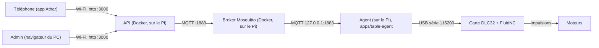

# Guide de test sur place — équipe de Dubai

Ce guide vous mène, pas à pas, de la carte SD vierge jusqu'à une table qui dessine.
Tout tourne **sur place**, sur un Raspberry Pi : le cloud Google n'est pas utilisé.

Chaque étape se termine par un critère **✅ Validé quand…**. Ne passez à l'étape suivante
que si ce critère est vrai. Si ce n'est pas le cas : tableau de dépannage (section 10), puis
rapport (section 11).

> **Ce qui a été vérifié, et ce qui ne l'a pas été.** Les étapes C et D (API, broker
> Mosquitto, comptes, création de table, état « en ligne ») ont été **exécutées de bout en bout**
> sur un PC (x86). Elles n'ont **pas** été jouées sur un vrai Raspberry Pi, ni avec un DLC32,
> ni avec un téléphone. L'agent (`apps/table-agent`, étape F) existe et est couvert par ses propres
> tests (sans matériel), mais n'a pas encore tourné sur un vrai Pi avec une vraie carte au moment
> d'écrire ces lignes — c'est justement ce que ce guide vous fait valider.
> Si une commande se comporte autrement chez vous, c'est une information précieuse :
> envoyez le rapport (section 11).

## Sommaire

1. [Architecture de test](#1-architecture-de-test)
2. [Matériel et règles de sécurité](#2-matériel-et-règles-de-sécurité)
3. [Étape A — Préparer le Pi](#3-étape-a--préparer-le-pi)
4. [Étape B — Outils et dépôt](#4-étape-b--outils-et-dépôt)
5. [Étape C — Lancer l'API et le broker](#5-étape-c--lancer-lapi-et-le-broker)
6. [Étape D — Enregistrer une table](#6-étape-d--enregistrer-une-table)
7. [Étape E — La carte DLC32 (FluidNC)](#7-étape-e--la-carte-dlc32-fluidnc)
8. [Étape F — Agent et application mobile](#8-étape-f--agent-et-application-mobile)
9. [Étape G — Sable et pannes (N4 et N5)](#9-étape-g--sable-et-pannes-n4-et-n5)
10. [Aide-mémoire et dépannage](#10-aide-mémoire-et-dépannage)
11. [Modèle de rapport](#11-modèle-de-rapport)

---

## 1. Architecture de test



- L'**API** et le **broker** tournent dans Docker sur le Pi (`deploy/docker-compose.yml`
  - `deploy/docker-compose.local.yml`). Le téléphone et le PC se connectent à l'API par le Wi-Fi.
- L'**agent** (`apps/table-agent`) est le programme qui fait le lien entre le broker et la carte :
  il convertit un dessin (`theta`/`rho`) en G-code, le streame à la carte, et remonte l'état
  (étape F1 ci-dessous).
- La carte **DLC32** exécute FluidNC. Le Pi lui envoie du G-code par le câble USB.

Une fois la table qui dessine, le chemin sera : téléphone → API → broker → agent → USB → DLC32 → moteurs.

## 2. Matériel et règles de sécurité

| Matériel                                 | Rôle                                                           |
| ---------------------------------------- | -------------------------------------------------------------- |
| Raspberry Pi 5 + carte SD (ou SSD)       | héberge l'API, le broker et (plus tard) l'agent                |
| **Alimentation officielle 27 W** du Pi 5 | une alim trop faible provoque des plantages bizarres           |
| Carte **MKS DLC32 V2.2**                 | contrôle les moteurs (FluidNC)                                 |
| **Alimentation séparée** du DLC32        | celle prévue pour la carte (voir sa fiche), jamais celle du Pi |
| Câble USB **de données** Pi ↔ DLC32      | un câble « charge seulement » ne marche pas                    |
| Un **ESP32 seul**                        | carte d'essai : on s'entraîne dessus, sans moteurs             |
| Un PC sur le même Wi-Fi, un téléphone    | pour l'admin et l'application                                  |

**Règles de sécurité (non négociables) :**

1. **Jamais** brancher ou débrancher un moteur **sous tension** : le driver peut être détruit.
2. L'alimentation des moteurs reste **débranchée** tant que l'étape ne demande pas de les faire tourner.
3. Pour tout test avec moteurs : **une personne a la main sur l'interrupteur** de l'alimentation des moteurs, du début à la fin.
4. Le Pi et le DLC32 ont chacun leur alimentation. Ne reliez pas les deux alimentations entre elles.
5. En cas de doute (bruit, odeur, mouvement inattendu) : coupez l'alimentation des moteurs d'abord, posez les questions ensuite.

---

## 3. Étape A — Préparer le Pi

Sur votre PC :

1. Installez **Raspberry Pi Imager** (raspberrypi.com/software).
2. Dans Imager : appareil **Raspberry Pi 5** ; système **Raspberry Pi OS (other) → Raspberry Pi OS Lite (64-bit)** ; stockage : votre carte SD.
3. Dans les réglages de personnalisation d'Imager, renseignez :
   - nom d'hôte : `athar-pi`
   - un nom d'utilisateur et un mot de passe (notez-les)
   - le Wi-Fi sur lequel se feront les tests
   - **activer SSH** (authentification par mot de passe)
4. Écrivez la carte, insérez-la dans le Pi, branchez l'alimentation 27 W. Attendez environ 2 minutes.
5. Depuis le PC (même Wi-Fi) :

```bash
ssh VOTRE_UTILISATEUR@athar-pi.local
```

Si `athar-pi.local` n'est pas trouvé, cherchez l'adresse IP du Pi dans l'interface de votre box/routeur et utilisez `ssh VOTRE_UTILISATEUR@ADRESSE_IP`.

**✅ Validé quand** vous voyez une invite du type `VOTRE_UTILISATEUR@athar-pi:~ $` dans votre terminal SSH.

## 4. Étape B — Outils et dépôt

Toutes les commandes de cette section se tapent **dans le terminal SSH du Pi**.

```bash
sudo apt-get update && sudo apt-get install -y git curl gh
gh auth login
```

`gh auth login` pose des questions : choisissez **GitHub.com**, **HTTPS**, puis **Login with a web browser**. Il affiche un code : ouvrez la page indiquée sur votre PC et tapez-le.

Puis récupérez le dépôt et installez les outils :

```bash
gh repo clone chedi-ouerghi/athar-Official ~/athar-Official
cd ~/athar-Official
git switch chore/cleanup-hardware-guide   # tant que la Pull Request n'est pas fusionnée ; ensuite : git switch master
bash hardware/pi/setup-pi.sh
```

`setup-pi.sh` installe Docker, `mosquitto-clients` et les outils nécessaires à FluidNC, puis ajoute votre utilisateur aux groupes `docker` et `dialout`. **Déconnectez-vous puis reconnectez-vous en SSH** (`exit`, puis `ssh …` de nouveau), sinon les groupes ne sont pas actifs.

Créez enfin le raccourci `athar` (il désigne les deux fichiers Docker Compose, voir section 10) :

```bash
echo "alias athar='docker compose -f \$HOME/athar-Official/deploy/docker-compose.yml -f \$HOME/athar-Official/deploy/docker-compose.local.yml'" >> ~/.bashrc
source ~/.bashrc
```

**✅ Validé quand** ces commandes répondent sans erreur :

```bash
docker --version && docker compose version && gh --version
type athar
```

(la dernière doit afficher `athar is aliased to …`.)

---

## 5. Étape C — Lancer l'API et le broker

> Seules deux variables sont **à remplir** pour le mode local : `MQTT_USERNAME` et `MQTT_PASSWORD`
> (le compte de l'API sur le broker). Les autres (`NODE_ENV`, `TABLE_MODE`, `MQTT_URL`, `TRUST_PROXY`)
> sont déjà fixées par `docker-compose.local.yml`. Le schéma de l'API
> (`apps/api/src/config/environment.schema.ts`) n'exige **aucune** variable en mode développement ;
> il exige `MQTT_URL` en `mqtts://`/`wss://`, `MQTT_USERNAME`, `MQTT_PASSWORD` et `PUBLIC_LINK_BASE_URL`
> seulement en production (cloud). Sans `MQTT_USERNAME`/`MQTT_PASSWORD`, l'API démarre mais ne peut pas
> se connecter au broker : toutes les tables restent « hors ligne ».

### C1 — Le fichier `.env`

```bash
cd ~/athar-Official/deploy
cp .env.example .env
chmod 600 .env
PASS=$(openssl rand -hex 16)
sed -i "s/^MQTT_PASSWORD=.*/MQTT_PASSWORD=$PASS/" .env
cat .env
```

Vous devez voir `DOMAIN=localhost`, `MQTT_USERNAME=athar-api` et une ligne `MQTT_PASSWORD=` suivie de 32 caractères. Ce mot de passe est secret : il ne va **jamais** dans Git (le fichier est ignoré).

### C2 — Le compte `athar-api` sur le broker

```bash
cd ~/athar-Official/deploy
docker run --rm -it -v "$PWD/mosquitto:/m" eclipse-mosquitto:2 mosquitto_passwd -c /m/passwd athar-api
```

La commande demande un mot de passe (deux fois) : **tapez exactement le `MQTT_PASSWORD` du `.env`** (affichez-le avec `grep MQTT_PASSWORD .env` et copiez-le).

Puis donnez le fichier à l'utilisateur interne du broker (numéro 1883). Sans cela, le broker ne peut pas le lire et redémarre en boucle :

```bash
sudo chown 1883:1883 mosquitto/passwd && sudo chmod 600 mosquitto/passwd
```

Cette dernière commande est à **refaire après chaque ajout de compte**. L'option `-c` ne sert qu'**une seule fois** : elle crée le fichier. Pour ajouter un compte plus tard, ne la remettez pas.

### C3 — Construire l'image de l'API

```bash
athar build api
```

Compter plusieurs minutes la première fois (le Pi compile l'API ; l'image du cloud est en x86 et ne tourne pas sur un Pi).

### C4 — Créer le premier admin, **avant** de démarrer

La commande refuse de tourner si l'API est démarrée (le fichier des comptes est verrouillé). Sans admin, aucune table ne peut être enregistrée.

```bash
read -rs -p "Mot de passe admin (14 caractères minimum) : " ADMIN_PW; echo
printf '%s\n' "$ADMIN_PW" | athar run --rm --no-deps -T api node dist/cli/admin-create.js --email admin@exemple.com --name "Admin Dubai" --password-stdin
unset ADMIN_PW
```

Remplacez `admin@exemple.com` par un vrai e-mail. Retenez-le avec le mot de passe : ce sont vos identifiants de connexion à l'admin.

### C5 — Démarrer

```bash
athar up -d
athar ps
curl http://localhost:3000/health
curl http://localhost:3000/ready
athar logs mosquitto | grep athar-api
```

**✅ Validé quand :**

- `athar ps` montre `api` et `mosquitto` à l'état `Up` (aucun `Restarting`) ;
- `/health` répond `{"status":"ok",…}` et `/ready` répond `"tableMode":"hardware"` ;
- le journal de Mosquitto contient une ligne `New client connected … u'athar-api'` ;
- depuis le **navigateur du téléphone** (même Wi-Fi), `http://ADRESSE_IP_DU_PI:3000/health` répond aussi (l'adresse s'obtient sur le Pi avec `hostname -I`).

---

## 6. Étape D — Enregistrer une table

Une table a un **identifiant** généré par l'API (16 caractères minuscules/chiffres, par exemple `gsbdul574ds4dhvc`). Le **nom d'utilisateur MQTT de la table doit être égal à cet identifiant** : le broker n'autorise la table qu'à ses propres sujets.

> Il existe deux façons de créer une table : la ligne de commande (ci-dessous) ou l'interface d'administration, qui produit en plus le QR code d'appairage pour un client. L'interface est décrite pas à pas dans [`docs/admin.md`](../docs/admin.md). Pour tester le matériel, la ligne de commande suffit.

### D1 — Créer la table (API arrêtée)

```bash
athar stop api
athar run --rm --no-deps -T api node dist/cli/table-create.js --name "Table Dubai 1" --location "Atelier"
```

La réponse contient `Registered table …` : **copiez l'identifiant** et gardez-le dans une variable :

```bash
TABLE_ID=gsbdul574ds4dhvc   # ← remplacez par VOTRE identifiant, sans espace
```

### D2 — Donner un compte broker à la table

```bash
cd ~/athar-Official/deploy
docker run --rm -it -v "$PWD/mosquitto:/m" eclipse-mosquitto:2 mosquitto_passwd /m/passwd "$TABLE_ID"
sudo chown 1883:1883 mosquitto/passwd && sudo chmod 600 mosquitto/passwd
athar restart mosquitto
athar start api
```

Le mot de passe demandé est celui que **l'agent de cette table** utilisera : notez-le (il sera mis dans `/etc/athar/mqtt.secret` sur le Pi, étape F). Pas d'option `-c` ici.

### D3 — Faire semblant d'être la table (sans agent)

On publie à la main ce que l'agent publiera : « je suis en ligne ». Remplacez `MOT_DE_PASSE_DE_LA_TABLE` :

```bash
athar exec mosquitto mosquitto_pub -h localhost -u "$TABLE_ID" -P 'MOT_DE_PASSE_DE_LA_TABLE' -t "athar/v1/t/$TABLE_ID/presence" -r -q 1 -m online
```

Puis demandez à l'API l'état de la table, avec le compte admin :

```bash
read -rs -p "Mot de passe admin : " ADMIN_PW; echo
TOKEN=$(curl -s -X POST http://localhost:3000/api/v1/auth/login -H 'content-type: application/json' -d "{\"email\":\"admin@exemple.com\",\"password\":\"$ADMIN_PW\"}" | sed 's/.*"accessToken":"\([^"]*\)".*/\1/')
unset ADMIN_PW
curl -s "http://localhost:3000/api/v1/tables/$TABLE_ID" -H "authorization: Bearer $TOKEN"
```

(Le mot de passe admin ne doit pas contenir de guillemet ni de barre oblique inverse.)

**✅ Validé quand** la réponse contient `"connection":"online"`. Publiez ensuite `-m offline` à la place de `-m online` (même commande) et relancez le `curl` : il doit afficher `"connection":"offline"`.

_Contrôle de sécurité (facultatif) :_ un compte de table ne doit pas pouvoir écrire chez une autre. Dans un terminal, `athar exec mosquitto mosquitto_sub -h localhost -u athar-api -P 'MQTT_PASSWORD_DU_.ENV' -t 'athar/v1/t/+/presence' -v -W 8` ; pendant ces 8 secondes, dans un second terminal, publiez avec le compte de la table sur `athar/v1/t/autretable/presence` : le message ne doit **pas** apparaître dans le premier terminal.

---

## 7. Étape E — La carte DLC32 (FluidNC)

> **ESP32 seul d'abord.** Faites toute cette étape une première fois avec l'ESP32 seul : vous apprenez
> les gestes sans risque pour la vraie carte. FluidNC génère les impulsions même sans moteur
> branché. Ensuite refaites-la avec le DLC32. L'ESP32 et le DLC32 n'ont pas le même nom de port USB.

**Moteurs non alimentés pendant E1 à E4.** Le DLC32 n'a que son câble USB (et, si besoin pour le démarrer, son alimentation de logique, jamais celle des moteurs).

### E1 — Brancher et repérer le port

Branchez la carte au Pi en USB, **seule** (retirez les autres appareils USB : l'outil d'installation pourrait choisir le mauvais port).

```bash
ls -l /dev/serial/by-id/
```

**✅ Validé quand** une ligne apparaît (pour le DLC32 : un nom contenant `1a86` ou `USB_Serial`, la puce CH340 ; c'est le chemin attendu par `agent.example.yaml`). Notez-la. Si rien n'apparaît : câble « charge seulement » ou câble défectueux.

### E2 — Installer le firmware FluidNC officiel

On utilise le paquet officiel de FluidNC (version vérifiée pour ce guide : `v4.1.1` ; si une plus récente non « Pre » existe sur github.com/bdring/FluidNC/releases, prenez-la et adaptez le nom).

```bash
mkdir -p ~/fluidnc && cd ~/fluidnc
curl -LO https://github.com/bdring/FluidNC/releases/download/v4.1.1/fluidnc-v4.1.1-posix.zip
unzip fluidnc-v4.1.1-posix.zip
cd fluidnc-v4.1.1-posix
sh ./install-wifi.sh
sh ./install-fs.sh
```

- `install-wifi.sh` écrit le firmware (garde le Wi-Fi activé de FluidNC, même si on ne s'en sert pas ici).
- `install-fs.sh` crée la zone de fichiers. **À ne faire que pour une première installation** : il efface les fichiers de la carte, dont sa config.
- Au premier lancement, le message `SPIFFS: mount failed` est normal (la mémoire se formate).
- Si l'installation reste bloquée sur `Connecting .....___.....` puis échoue : voir le dépannage.

### E3 — Envoyer la configuration Athar

```bash
cd ~/fluidnc/fluidnc-v4.1.1-posix
sh ./fluidterm.sh -u ~/athar-Official/hardware/board/config.yaml
```

Le fichier est copié sur la carte sous le nom `config.yaml` (si plusieurs ports série existent, l'outil vous demande lequel). Ensuite ouvrez la console :

```bash
sh ./fluidterm.sh
```

Dans la console, redémarrez la carte avec `Ctrl+R` et lisez les messages de démarrage.

**✅ Validé quand** aucun message `[MSG:ERR:` n'apparaît au démarrage (un `Ignored key …` signifie une faute d'indentation ou un commentaire mal placé dans `config.yaml` : un commentaire doit être seul sur sa ligne).

### E4 — Premiers ordres, toujours sans moteur

Dans la console FluidTerm (pour quitter : `Ctrl+]`), tapez ces commandes l'une après l'autre :

| Tapez                             | Vous devez voir                                                                                     |
| --------------------------------- | --------------------------------------------------------------------------------------------------- |
| `$I`                              | des informations de version FluidNC, puis `ok`                                                      |
| `?`                               | une ligne `<Idle\|MPos:0.000,0.000,0.000\|…>` — **sans** `Pn:` tant qu'aucun capteur n'est actionné |
| `G91` puis `G1 X10 F600` puis `?` | `ok`, puis une position X qui a changé (`MPos:10.000,…`)                                            |
| `G90`                             | `ok` (on revient en coordonnées absolues)                                                           |

Si `?` affiche `Pn:X` ou `Pn:Y` alors qu'aucun capteur n'est touché, le niveau du capteur est inversé : voir l'explication en tête de `hardware/board/config.yaml` (ajouter `:low` à la broche), puis reprendre E3.

**✅ Validé quand** les quatre lignes ci-dessus donnent le résultat attendu avec l'ESP32 seul, puis avec le DLC32.

### E5 — Tests mécaniques (palier N3)

Avec le DLC32 seulement, et **alimentation des moteurs branchée pour la première fois**, appliquez les règles de sécurité de la section 2 (main sur l'interrupteur), puis suivez le **palier N3** de [`TESTING.md`](TESTING.md#n3--moteurs-sans-sable) : tests 3.1 à 3.9 (sens, fins de course, homing, calibrations, répétabilité). Les valeurs corrigées (`steps_per_mm`, `max_travel_mm`…) se reportent dans `hardware/board/config.yaml` ; renvoyez le fichier à la carte avec la commande de E3.

**✅ Validé quand** les neuf tests du palier N3 sont cochés dans `TESTING.md`.

---

## 8. Étape F — Agent et application mobile

### F1 — L'agent du Pi

L'agent (`apps/table-agent`) est le programme du Pi qui écoute le broker, convertit les dessins en
G-code et les envoie à la carte. Il remplace l'étape D3 (publier `online` à la main) : c'est lui qui
le fait désormais, au démarrage et via son Last Will.

Sur le Pi, dans `~/athar-Official` :

```bash
cp hardware/table-agent/agent.example.yaml /tmp/agent.yaml   # puis éditez-le (voir ci-dessous)
sudo mkdir -p /etc/athar
sudo mv /tmp/agent.yaml /etc/athar/agent.yaml
printf '%s' 'MOT_DE_PASSE_DE_LA_TABLE' | sudo tee /etc/athar/mqtt.secret >/dev/null   # le mot de passe de l'étape D2, sans retour à la ligne
sudo chmod 600 /etc/athar/mqtt.secret
pnpm install --filter @athar/table-agent...
pnpm --filter @athar/table-agent build
```

Dans `/etc/athar/agent.yaml`, remplacez `REPLACE_WITH_TABLE_ID` par `$TABLE_ID` (étape D), l'URL par
`mqtt://127.0.0.1:1883` (mode local, sans TLS : retirez aussi `ca_file`), et mesurez `radius_mm` au
montage. Puis un premier contrôle sans toucher aux moteurs :

```bash
node apps/table-agent/dist/cli/selftest.js
```

**✅ Validé quand** chaque ligne du rapport affiche `[OK]` (sauf `motors`, normal sans `--motors`).
Une fois vert, lancez l'agent au premier plan pour observer ses journaux :

```bash
node apps/table-agent/dist/cli/main.js
```

Et seulement après un `selftest` vert à froid, installez le service (section 10, et
[`table-agent/athar-agent.service`](table-agent/athar-agent.service)) pour qu'il démarre tout seul au
redémarrage du Pi.

### F2 — L'application mobile (sur votre PC, pas sur le Pi)

Il faut Node.js 20.19 ou plus récent sur le PC. Dans le dossier du dépôt cloné sur le PC :

```bash
corepack enable
pnpm install
cp apps/mobile/.env.example apps/mobile/.env
```

Éditez `apps/mobile/.env` et **décommentez et complétez** cette ligne, avec l'adresse IP du Pi (`hostname -I` sur le Pi) :

```
EXPO_PUBLIC_API_BASE_URL=http://ADRESSE_IP_DU_PI:3000
```

C'est la variable lue par `apps/mobile/src/config/env.ts`. Sans elle, l'application vise `localhost` ou `10.0.2.2` et ne trouve pas le Pi. Puis lancez :

```bash
pnpm dev:mobile
```

Ouvrez l'application sur le téléphone (même Wi-Fi). Si vous changez la variable plus tard, relancez avec `pnpm --filter @athar/mobile start --clear`.

**✅ Validé quand** l'application s'ouvre sur le téléphone et son écran « Connection details » (ou la page de diagnostic) indique que l'API répond et que son mode est `hardware`.

Le parcours client complet (créer un client, préparer une table pour lui, scanner le QR code) est décrit dans [`docs/admin.md`](../docs/admin.md), et un dessin démarre vraiment une fois l'agent lancé (étape F1).

---

## 9. Étape G — Sable et pannes (N4 et N5)

Réservé à la suite, quand l'agent existera et que le palier N3 est entièrement validé.

- **N4 — sable** : [`TESTING.md`](TESTING.md#n4--sable) (formes, vitesse de bille, endurance).
- **N5 — pannes provoquées** : [`TESTING.md`](TESTING.md#n5--pannes-provoquées-avant-toute-démo-client) (Wi-Fi coupé, courant coupé, USB débranché, broker redémarré).

Sur place, pour N5, « broker redémarré » se fait avec `athar restart mosquitto`, et « API redéployée » avec `cd ~/athar-Official && git pull && athar up -d --build`.

**✅ Validé quand** toutes les cases de N4 et N5 sont cochées.

---

## 10. Aide-mémoire et dépannage

### Commandes utiles

`athar` est le raccourci créé à l'étape B : il est équivalent à `docker compose -f deploy/docker-compose.yml -f deploy/docker-compose.local.yml`.

| Je veux…                                  | Commande                                                                                    |
| ----------------------------------------- | ------------------------------------------------------------------------------------------- |
| voir l'état                               | `athar ps`                                                                                  |
| suivre les journaux de l'API              | `athar logs -f api`                                                                         |
| suivre les journaux du broker             | `athar logs -f mosquitto`                                                                   |
| démarrer / arrêter                        | `athar up -d` / `athar stop`                                                                |
| redémarrer un service                     | `athar restart api` ou `athar restart mosquitto`                                            |
| appliquer une mise à jour du code         | `cd ~/athar-Official && git pull && athar up -d --build`                                    |
| prendre en compte un `.env` modifié       | `athar up -d --force-recreate api`                                                          |
| trouver l'adresse IP du Pi                | `hostname -I`                                                                               |
| sauvegarder les données de l'API          | `docker run --rm -v deploy_api-data:/d -v "$PWD":/b alpine tar czf /b/api-data.tgz -C /d .` |
| **tout supprimer, y compris les données** | `athar down -v` ⚠ efface les comptes, tables et mots de passe de l'API                      |

`athar down` (sans `-v`) arrête tout **en gardant** les données.

### Dépannage

| Symptôme                                                                | Cause probable                                                                                                | Que faire                                                                                                                                 |
| ----------------------------------------------------------------------- | ------------------------------------------------------------------------------------------------------------- | ----------------------------------------------------------------------------------------------------------------------------------------- |
| `athar: command not found`                                              | le raccourci n'est pas chargé                                                                                 | `source ~/.bashrc` (ou rouvrir la session SSH)                                                                                            |
| `permission denied … docker.sock`                                       | les groupes ne sont pas actifs                                                                                | quitter et rouvrir la session SSH (étape B)                                                                                               |
| Mosquitto en `Restarting`, journal : `Unable to open pwfile`            | `passwd` n'appartient pas à l'utilisateur 1883                                                                | `sudo chown 1883:1883 deploy/mosquitto/passwd && sudo chmod 600 deploy/mosquitto/passwd` puis `athar restart mosquitto`                   |
| Mosquitto : `Invalid line in password file`                             | un compte a été créé avec un nom vide (variable `TABLE_ID` vide)                                              | supprimer le fichier (`rm deploy/mosquitto/passwd`), refaire C2 avec `-c`, puis D2 avec un `TABLE_ID` rempli                              |
| `mosquitto_passwd` : `Unable to open file … File exists`                | l'option `-c` sur un fichier existant                                                                         | enlever `-c` pour ajouter un compte ; pour repartir de zéro, `rm deploy/mosquitto/passwd` d'abord                                         |
| `athar up` : Mosquitto ne démarre pas, `passwd` est un **dossier**      | Docker l'a créé car le fichier n'existait pas                                                                 | `sudo rm -r deploy/mosquitto/passwd`, refaire C2 **avant** `up`                                                                           |
| Journal API : `MQTT client error: connect ECONNREFUSED`                 | le broker n'est pas démarré                                                                                   | `athar ps`, `athar logs mosquitto` ; l'API se reconnecte seule dès que le broker revient                                                  |
| Les tables restent `offline`, journal broker : `not authorised`         | `MQTT_PASSWORD` du `.env` ≠ mot de passe donné à `mosquitto_passwd` pour `athar-api`                          | corriger l'un des deux ; si c'est le `.env` : `athar up -d --force-recreate api`                                                          |
| `admin-create` ou `table-create` : `… is open for writing by process …` | l'API tourne et garde le fichier                                                                              | `athar stop api`, relancer la commande, puis `athar start api`. **Ne supprimez pas** le fichier `.lock`                                   |
| `table-create` réussit mais la table reste `offline`                    | pas de compte broker pour cet identifiant, faute de frappe dans l'identifiant, ou personne ne publie `online` | refaire D2 puis D3 ; comparer l'identifiant caractère par caractère                                                                       |
| Le téléphone n'atteint pas l'API                                        | autre Wi-Fi, mauvaise adresse, variable absente                                                               | ouvrir `http://IP_DU_PI:3000/health` dans le navigateur du téléphone ; vérifier `EXPO_PUBLIC_API_BASE_URL` ; relancer avec `--clear`      |
| L'admin affiche `Cannot reach … CORS`                                   | la page est ouverte autrement que depuis `http://localhost:<port>`                                            | voir [`docs/admin.md`](../docs/admin.md) (l'API en mode local n'accepte que les pages venant de `localhost`)                              |
| `/dev/serial/by-id/` est vide                                           | câble « charge seulement », carte non alimentée                                                               | autre câble USB de données ; `dmesg \| tail`                                                                                              |
| `install-wifi.sh` : `Connecting .....___.....` puis échec               | la carte ne passe pas en mode chargement                                                                      | FAQ officielle FluidNC « Connecting … times out » (wiki.fluidnc.com/en/support/faq) ; fermer tout autre programme qui tient le port série |
| FluidNC : `[MSG:ERR: Ignored key …]` au démarrage                       | indentation fausse ou commentaire après une valeur dans `config.yaml`                                         | corriger le fichier (un commentaire = une ligne à lui seul), refaire E3                                                                   |
| `?` affiche `Pn:X` ou `Pn:Y` au repos                                   | niveau du capteur inversé                                                                                     | ajouter `:low` à la broche concernée (voir `config.yaml`), refaire E3                                                                     |
| Le moteur tourne à l'envers                                             | sens du câblage                                                                                               | ajouter `:low` à `direction_pin` de l'axe, refaire E3                                                                                     |
| `docker build` échoue (`no space left`, ou le Pi se fige)               | disque plein ou mémoire                                                                                       | `df -h` ; libérer de la place avec `docker system prune` ; relancer `athar build api`                                                     |

---

## 11. Modèle de rapport

Copiez ce texte, remplissez-le, et envoyez-le **à la fin de chaque étape**, qu'elle ait réussi ou non.

```text
RAPPORT — Étape : ____ (A, B, C, D, E, F ou G)
Date / heure : ____          Qui : ____
Résultat : ✅ validé   /   ❌ bloqué

Matériel : Raspberry Pi 5 (RAM : ___ Go) / carte : DLC32 V2.2 ou ESP32 seul
Version du dépôt : (sortie de `cd ~/athar-Official && git rev-parse --short HEAD`) ____

Le critère « Validé quand » est-il vrai ?  oui / non — lequel précisément ? ____

Si ❌ :
  Dernière commande tapée : ____
  Message d'erreur (copié-collé, pas une photo si possible) : ____
  Ce que j'ai déjà essayé : ____

Sorties à joindre selon l'étape :
  C, D :  `athar ps`            et   `athar logs --tail 50 api`   et   `athar logs --tail 50 mosquitto`
  E     :  `ls -l /dev/serial/by-id/`   et le texte affiché par FluidTerm au démarrage de la carte
  F     :  la ligne `EXPO_PUBLIC_API_BASE_URL` de apps/mobile/.env (sans rien d'autre) et une capture de l'écran de l'application

Ne joignez JAMAIS : le fichier deploy/.env, le fichier deploy/mosquitto/passwd, ni aucun mot de passe.
```
